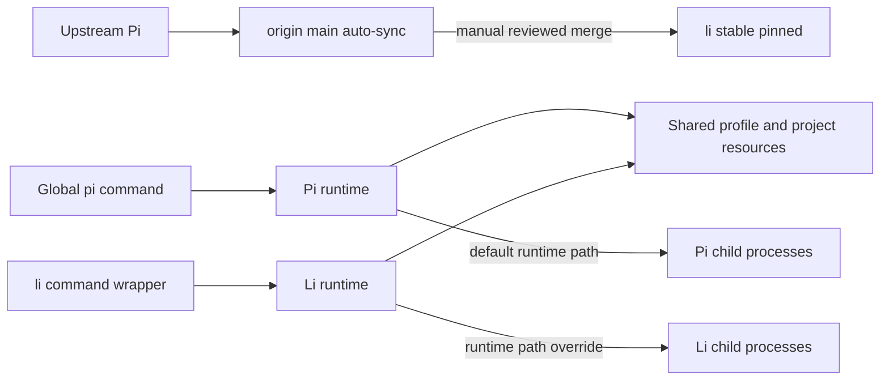

# Spec: Li — Pi riêng, dùng chung state nhưng tự quản update

## Context Snapshot
- **Project:** `nguyendinhquocx/pi-mono`, fork public của `earendil-works/pi`; root là repository này.
- **Snapshot được review:** nhánh local `main`, SHA `aec1077b19cfa5ce8562c4d48d1f35c38d699812`, working tree sạch tại lúc lập spec. Package `@earendil-works/pi-coding-agent` báo `1.3.0`; đây là source trên fork `main`, không đồng nghĩa chỉ có source release tag `v1.3.0`.
- **Fork flow hiện tại:** `.github/workflows/sync-upstream.yml` tự merge upstream vào nhánh mặc định `main` theo lịch; GitHub báo fork đang ahead 109 / behind 1 so với upstream tại thời điểm kiểm tra. Không sửa workflow hoặc dùng `main` làm nhánh Li đã pin.
- **Stack/build:** TypeScript/Node.js ≥22.19; npm workspaces, `package-lock.json`; CLI và SDK nằm trong `packages/coding-agent`, các package nội bộ gồm `agent`, `ai`, `tui`, `codemode`, `mcp` và các package khác trong `packages/`.
- **Current behavior:** lệnh `pi` hiện dùng Pi cài global. Pi mặc định dùng `~/.pi/agent`; sessions còn được nhóm theo working directory. Các extension và skills hiện tại của user chạy từ profile dùng chung.
- **Desired behavior:** `pi` tiếp tục là Pi global, update theo đường hiện tại. `li` chạy bản build riêng trên nhánh `li/stable`, không tự update theo upstream. Cả hai dùng cùng profile/session/project resources khi tương thích; việc đưa source Pi mới vào Li là thao tác thủ công có review và verify.
- **Relevant project files:** `AGENTS.md`, `package.json`, `packages/coding-agent/package.json`, `packages/coding-agent/src/config.ts`, `packages/coding-agent/src/package-manager-cli.ts`, `packages/coding-agent/src/utils/version-check.ts`, `packages/coding-agent/src/core/session-manager.ts`, `packages/coding-agent/src/core/extensions/loader.ts`, `scripts/build-binaries.sh`, `.github/workflows/sync-upstream.yml`.
- **Không dùng làm baseline:** snapshot local cũ `pi-main` báo package `0.74.1`; Li lấy source từ fork này, không build từ snapshot đó.
- **External integration files:** source root `D:\pcloud\workspace\code\python\app_presets\pi\extensions\`; các file liên quan `subagent-tab/index.ts`, `handoff/index.ts`, `peer-sessions/parent-launcher.ts`, `pi-osc-patch-guard/index.ts`. Runtime root là `%PI_CODING_AGENT_DIR%\extensions`; deploy theo source-to-runtime flow hiện có, không sửa runtime copy trực tiếp.
- **Existing constraints:** repo `AGENTS.md` yêu cầu Node/npm theo lockfile, `npm ci --ignore-scripts`, `npm run check` sau đổi code; không chạy full `npm test`, build hoặc test khi chưa nằm trong task user đã duyệt. Pi README xác nhận Pi không sandbox filesystem/process/network; Li cũng chạy với quyền của user.

## Objective
- Tạo một lệnh `li` chạy Pi build riêng từ source fork; `pi` global vẫn nguyên vẹn.
- `li` có SDK/package exports của source Li, mở được cùng config, extension, skills, auth và sessions với Pi khi state tương thích.
- Pi và Li có source/build/update lifecycle riêng; Pi update không tự đổi binary/source Li, còn Li không có self-update ngầm lên package upstream.
- Hoàn thành một baseline Windows x64 chạy song song; chứng minh child workers của Li chạy Li, không patch nhầm Pi global, và Li vẫn boot khi Pi global command/package không khả dụng.

## Scope
- **In:** nhánh Li riêng trên fork; Node-based CLI wrapper `li`; identity Li nhưng giữ config directory `.pi`; alias env để dùng profile Pi; guard self-update; runtime-aware extension spawning; tách đích patch của OSC guard; giữ SDK exports; test session/config compatibility, Pi-absent operation và rollback; tài liệu hóa quy trình kiểm tra/merge upstream thủ công.
- **Out:** dịch UI sang tiếng Việt; standalone Bun binary; macOS/Linux support; sửa toàn bộ 30 extensions; nhúng SDK vào một app ngoài; gỡ Pi global thật khỏi máy trong task này; public release/binary distribution; tự push branch hoặc thay đổi `main`.
- **Pre-lock gate:** rút gọn — không có visual redesign; user đã chốt job chính là gọi `pi` hoặc `li` trực tiếp. UX evidence cần xác nhận command, CWD, session và child runtime; không chạy Surf visual review.

## User Flow
- **App type:** CLI/TUI coding agent.
- **Job:** mở đúng runtime (`pi` hoặc `li`) ngay trong project hiện tại mà không mất continuity.
- **Journey:** user `cd` vào project → gõ `pi` hoặc `li` → runtime tương ứng mở TUI tại cùng CWD → chọn/tiếp tục session từ profile chung → extensions chạy child process cùng runtime → thoát; không có màn chọn Pi/Li.
- **Default path:** gõ `li` để vào Li; không hỏi xác nhận hay chọn profile.
- **Advanced path:** `li --version` kiểm tra identity/base; `li update --extensions` chỉ chạy khi user gọi rõ và chấp nhận package cache chung.
- **State continuity:** sessions vẫn nhóm theo CWD và cùng `~/.pi/agent`; mỗi session file chỉ một runtime ghi tại một thời điểm.
- **Error/recovery:** thiếu shim/build hoặc extension spawn sai path phải báo cụ thể và dừng; unsupported session entry phải fail closed; `li update` không tự chạy package manager.
- **Trade-off:** cùng profile giảm ma sát nhưng tạo shared fate cho settings/extensions/sessions; Li chỉ hỗ trợ data state đã qua compatibility gate.

## UX Baseline
| Mục | Baseline |
|---|---|
| Keyboard | Không đổi keybinding TUI; `li` là lệnh trực tiếp, không thêm menu chọn runtime. |
| Focus | N/A — không thêm control hoặc màn hình mới. |
| A11y | N/A — giữ nguyên TUI hiện có, không thêm control. |
| Viewport | Giữ render hiện tại; smoke TUI trên terminal 80x24 và cửa sổ hẹp để bắt lỗi launcher/extension. |
| States | Launcher/update lỗi phải nêu nguyên nhân và cách phục hồi; không fallback âm thầm sang Pi. |
| Nhất quán | Giữ theme, shortcut, prompt và session view của Pi. |
| Platform surfaces | Windows x64; WezTerm với PowerShell/Git Bash. |
| Copy | Version/help/update refusal phải gọi đúng tên `Li`, không hướng user chạy `pi update` để cập nhật Li. |

## Thuật ngữ
- **`main`:** nhánh mặc định của fork, GitHub sync workflow tự merge upstream vào đây; không dùng làm runtime pin cho Li. Các delta đang có của fork không bị xóa.
- **`li/stable`:** nhánh source riêng của Li; chỉ thay đổi khi user duyệt merge/update.
- **Agent directory:** profile cấp user thường ở `~/.pi/agent`, chứa settings/auth/models/sessions/resources/packages.
- **Project resources:** `.pi/` trong CWD, ví dụ settings/extensions/skills cục bộ của project.
- **Self-update:** thay chính CLI/package Li. Khác với update extension package hoặc model catalog đang nằm trong profile dùng chung.
- **Context edit:** session entry có thể thay/ẩn nội dung gửi vào model context mà không xóa transcript gốc; reader không hiểu entry này không được phép gửi nguyên nội dung gốc đi như bình thường.
- **Runtime identity:** `APP_NAME` của Pi; nó định danh UI và tên biến môi trường kiểu `LI_CODING_AGENT_DIR`, không tự đổi `configDir`.

## Assumptions
1. Li v1 chỉ hỗ trợ Windows x64, Node.js và terminal hiện tại của user; không cần build standalone binary để đạt mục tiêu.
2. Snapshot ban đầu là full SHA `aec1077b19cfa5ce8562c4d48d1f35c38d699812`, trừ khi user duyệt sync fork trước khi implement. Không dùng `latest` hoặc nhánh mutable làm build identity.
3. Giữ package name `@earendil-works/pi-coding-agent` trong private workspace để extension alias và internal imports tiếp tục khớp; **không** `npm link`/cài global package này từ Li.
4. `piConfig.name` của Li là `li`; `piConfig.configDir` vẫn `.pi`. Launcher ánh xạ `LI_CODING_AGENT_DIR` sang profile hiện tại và giữ các biến `PI_*` cho extension/script cũ.
5. Cùng session file chỉ được mở bởi một runtime tại một thời điểm. Chưa có cross-process writer lock giữa Pi và Li.
6. Extension package/state trong profile là shared resource: update package qua Pi hoặc Li ảnh hưởng cả hai; đây không phải cơ chế update riêng cho mỗi runtime.
7. Pi global vẫn được giữ trong lúc triển khai; Li phải chứng minh chạy độc lập trong môi trường test cô lập trước khi user cân nhắc gỡ Pi thật.
8. Mọi migration startup và compatibility smoke đầu tiên chạy trên bản sao agent directory + CWD `.pi`; chỉ mở profile thật sau khi diff/migration được review và có recovery snapshot.

## Open Questions
- **Public branch:** mặc định tạo `li/stable` local, chưa push lên fork public. User phải chốt riêng trước khi push branch Li lên GitHub.
- **Local commit:** repo `AGENTS.md` cấm commit nếu user chưa yêu cầu. Để merge/update Li lâu dài nên commit patch Li lên `li/stable` sau UAT; xin quyết định riêng, không push theo ngầm định.
- **Sync trước build:** fork `main` đang behind upstream một commit tại snapshot. Mặc định dùng SHA ghi trong spec; nếu muốn lấy commit mới hơn thì phải review diff và cập nhật baseline trước khi tạo Li.

## Approach
- Giữ fork `main` làm upstream-sync mirror. Tạo worktree riêng `li/stable` từ SHA đã pin tại `D:\pcloud\workspace\code\pi-mono-li`; không sửa `main` hoặc `.github/workflows/sync-upstream.yml`.
- Build Node bundle từ workspace Li; không dùng `build-binaries.sh`/Bun standalone trong v1 vì `subagent-tab` hiện giả định `process.execPath` là Node khi spawn child.
- Thêm wrapper `bin/li.cmd` trong worktree Li; dùng `setlocal`, resolve canonical `LI_ROOT` từ vị trí wrapper, đặt `LI_RUNTIME=1`, `PI_PACKAGE_DIR=%LI_ROOT%\packages\coding-agent`, `PI_CORE_CLI_PATH=%LI_ROOT%\packages\coding-agent\dist\bundle\cli.js`, `PI_OSC_GUARD_DIST`, `PI_SKIP_VERSION_CHECK=1`, ánh xạ `LI_CODING_AGENT_DIR`/`LI_CODING_AGENT_SESSION_DIR` từ giá trị `PI_*` nếu có, và giữ nguyên CWD/arguments. Nếu biến `LI_*` và `PI_*` tương ứng cùng được set nhưng khác path thì dừng, không tự chọn một profile. Đưa đúng `bin` directory vào user PATH sau khi kiểm tra không có lệnh `li` đang tồn tại. Không sửa `pi.cmd` hoặc npm global Pi.
- Đặt `piConfig.name = "li"`, giữ `configDir = ".pi"`. Chặn self-update trong CLI Li bằng thông báo chỉ cách update source; version notice bị tắt trong wrapper nhưng đây không được coi là self-update guard. Các lệnh update extension/model chỉ chạy khi user gọi rõ và phải cảnh báo profile/package cache là shared.
- Extension subprocesses dùng một helper chung `shared/resolve-runtime-cli.ts`: `PI_CORE_CLI_PATH` hợp lệ là nguồn authoritative; Li mode thiếu/sai path thì fail closed, Pi mode chỉ dò APPDATA thông thường và không dùng absolute path gắn với user cụ thể. Áp dụng helper cho `subagent-tab`, `peer-sessions` và `handoff`; Li đặt `PI_OSC_GUARD_DIST` trỏ vào dist Li để guard không sửa bundle Pi global. Wrapper dùng `setlocal` để không làm rò override sang shell/`pi` bên ngoài.
- Entry production của Li là `dist/bundle/cli.js`: bundled Node dùng `virtualModules` để cung cấp Pi packages từ cùng Li build; `jiti` phải có trong `node_modules` Li worktree. Với unbundled development CLI, aliases phải resolve đủ workspace `dist`; thiếu package nội bộ là FAIL, không âm thầm trộn bản npm upstream.
- Trước khi gọi Li là độc lập, chạy smoke trong môi trường cô lập không có Pi global trong PATH hoặc APPDATA npm; Li và child processes vẫn phải chạy từ Li worktree. Vì `main.ts` gọi `runMigrations(cwd)` trước khi mở session, migration rehearsal phải dùng agentDir/CWD `.pi` fixture copy. Trước lần mở profile thật, tạo và verify recovery snapshot ngoài repo/worktree với ACL user-only; không log hoặc upload auth values.
- Cùng profile/session chỉ được chia sẻ sau compatibility gate. Pi/Li không được ghi cùng một session đồng thời. Session reader của Li phải fail closed nếu gặp entry/context-transform không hiểu; đặc biệt không gửi nội dung transcript gốc khi session có `context_edit` chưa hỗ trợ.

## Diagram

## Bỏ qua
- Không dịch built-in TUI sang tiếng Việt trong spec này; đó là patch riêng sau khi Li coexistence PASS.
- Không đổi `main` auto-sync workflow, không cài/ghi đè Pi global, không tự push, không tạo release, không chạy self-update.
- Không hứa mọi phiên bản Pi tương lai tương thích với Li cũ; mỗi lần merge cần compatibility evidence.
- Không thêm sandbox/permission system: đây là fork runtime, không phải bảo mật process boundary.

## Risks
- `main` tự sync; nếu Li wrapper trỏ vào main thay vì worktree `li/stable`, update upstream sẽ lọt vào Li ngoài ý muốn.
- Bỏ Pi global trước khi Pi-absent smoke PASS có thể làm child launcher hoặc bare package import fail dù TUI Li chính vẫn mở được.
- `piConfig.name = li` đổi prefix env sang `LI_*`; thiếu alias có thể làm Li dùng profile/session directory khác Pi.
- `li update` có thể cài package upstream hoặc sửa global npm nếu self-update không bị chặn.
- `subagent-tab` hardcode global Pi CLI; `handoff` gọi literal `pi`; child có thể chạy sai runtime nếu không có seam.
- `pi-osc-patch-guard` mặc định nhắm dist global Pi; không đặt target Li sẽ khiến Li tác động Pi.
- Pi mới có thể thêm session entry ngữ nghĩa mới dù header version không đổi; kiểm tra version marker đơn lẻ không đủ bảo đảm an toàn.
- Pi và Li chia sẻ auth, extension packages, settings và session JSONL; extension update qua runtime này có thể làm runtime kia lỗi. Startup migration có thể ghi state trước khi session compatibility guard chạy, nên Pi-absent/profile smoke phải chạy trên copy trước.
- `APP_NAME=li` không biến Li thành sandbox; extension/build chạy với quyền user đầy đủ.

## Task List

### Task 1 — Pin nhánh Li, giữ `main` làm upstream mirror
- Acceptance: trước khi tạo worktree, xác minh GitHub `default_branch` vẫn là `main`; nếu khác thì BLOCKED vì sync workflow bám default branch. Nếu branch/worktree chưa tồn tại, tạo `li/stable` worktree tại SHA `aec1077b19cfa5ce8562c4d48d1f35c38d699812`; nếu đã tồn tại thì dừng và inspect, không ghi đè. `main` checkout và workflow auto-sync không bị sửa; SHA Li không đổi khi `origin/main` được fetch/update.
- Files: Git refs/worktree của repo này; `.github/workflows/sync-upstream.yml` là read-only reference. Pattern: workflow lấy `repository.default_branch`, nên chỉ nhánh mặc định được lịch sync cập nhật.
- Reproduce: kiểm tra GitHub `default_branch` bằng `py -3.13 D:\pcloud\workspace\code\python\quoc.py --github-repo-info nguyendinhquocx/pi-mono --json`; phải là `main`. Sau đó từ root repo chạy `git worktree add -b li/stable D:\pcloud\workspace\code\pi-mono-li aec1077b19cfa5ce8562c4d48d1f35c38d699812`; `git -C D:\pcloud\workspace\code\pi-mono-li rev-parse HEAD` phải trả đúng SHA trên.
- Verify: `git worktree list`; `git -C D:\pcloud\workspace\code\pi-mono status --short --branch`; kiểm tra nhánh Li không nằm trong trigger sync workflow.

### Task 2 — Runtime identity `li`, shared profile và command shim
- Acceptance: `where.exe pi` vẫn trỏ Pi global; `where.exe li` trỏ shim Li; `pi --version` không đổi; `li --version` in đúng format `li <Pi-base-version> (source <short-SHA>)`; build receipt lưu full SHA, base version và artifact hash. Chạy từ bất kỳ CWD nào, Li giữ nguyên CWD; `PI_PACKAGE_DIR` luôn trỏ package Li, còn `PI_*` profile/session custom và default `~/.pi/agent` được Li ánh xạ đúng. Nếu `PI_*_DIR` và `LI_*_DIR` cùng tồn tại nhưng khác path thì Li fail closed. CLI `--session-dir` vẫn override env theo contract Pi. Không có install/link nào ghi đè package hoặc shim Pi.
- UX Contract: mặc định gõ `li` mở ngay Li TUI; không hỏi chọn runtime, không mở wizard. CWD quyết định project resources/session grouping như Pi. Nếu `li` shim thiếu hoặc Li build không tồn tại, báo lỗi path cụ thể và dừng; không fallback sang `pi`.
- Skills: `flow`, `pi-build-extension`.
- Visual Ref: không đổi UI; dùng TUI Pi hiện tại làm baseline.
- Files: `packages/coding-agent/package.json` (pattern: `piConfig` và `bin` hiện có); `packages/coding-agent/src/config.ts` (`APP_NAME`, `CONFIG_DIR_NAME`, `ENV_AGENT_DIR`, `ENV_SESSION_DIR`); `bin/li.cmd` (file mới, xử lý `--version` từ receipt); `scripts/build-li.mjs` (build orchestrator/provenance mới); `packages/coding-agent/dist/li-build-receipt.json` (generated); `packages/coding-agent/test/li-runtime-config.test.ts` (test mới).
- Reproduce: mở PowerShell mới, chạy `where.exe pi`, `where.exe li`, `cd D:\`, `li --version`, rồi `li`. Với isolated test, cố tình set `PI_PACKAGE_DIR` sang một Pi package path khác; wrapper vẫn phải resolve Li package.
- Verify: `npm --prefix packages/coding-agent test -- test/li-runtime-config.test.ts`; kiểm tra resolver trả cùng agent/session path cho PI profile mặc định/custom, từ chối `PI_*_DIR`/`LI_*_DIR` conflict và giữ `--session-dir` precedence.

### Task 3 — Chặn self-update của Li
- Acceptance: mọi target có self-update (`li update` mặc định, `li update self`, `li update pi`, `--self`, `--all`, `--force`, kể cả tổ hợp) bị từ chối trước khi update extension hoặc spawn npm/pnpm/install/remove. `PI_SKIP_VERSION_CHECK=1` chỉ suppresses nag, không thay guard. Chỉ `--extensions`, `--models` hoặc update một package cụ thể được phép khi gọi rõ, kèm cảnh báo shared cache.
- UX Contract: refusal nói ngắn gọn Li được nâng bằng merge/build đã review; không hiển thị lệnh `pi update` như cách cập nhật Li. Extension/model updates luôn nêu rằng chúng tác động cả Pi và Li.
- Skills: `create-cli`, `flow`.
- Visual Ref: terminal text only; không thay TUI.
- Files: `packages/coding-agent/src/package-manager-cli.ts` (pattern: `getSelfUpdatePlan`/`runSelfUpdate`); `packages/coding-agent/test/li-self-update.test.ts` (test mới); wrapper `bin/li.cmd`.
- Reproduce: `npm --prefix packages/coding-agent test -- test/li-self-update.test.ts`.
- Verify: test cả `update`, `update self`, `update pi`, `--self`, `--all`, `--force` và tổ hợp; target có self bị block trước khi package update bắt đầu, mock package manager ghi nhận zero spawn/install/remove và package updater ghi nhận zero call. `--extensions`/`--models` explicit vẫn hoạt động với shared-cache warning. Pi global `pi update` path và behavior không đổi.

### Task 4 — Runtime-aware extension spawning và target patch riêng
- Acceptance: cả ba spawn site (`subagent-tab`, peer parent launcher, handoff) dùng cùng helper trả về Node + absolute CLI path đã `existsSync` validate. Li wrapper đặt `PI_CORE_CLI_PATH` chính xác tới Li `packages/coding-agent/dist/bundle/cli.js`. Li mode (`LI_RUNTIME=1`) bắt buộc override hợp lệ; thiếu/sai thì fail closed, không thử APPDATA/PATH/literal fallback. Pi mode dùng APPDATA candidate tổng quát, ưu tiên `dist/bundle/cli.js`, rồi `dist/cli.js` nếu tồn tại; không hardcode username. Child process giữ đúng agent/session dirs của parent. OSC guard khi chạy Li chỉ sửa Li dist; Pi global dist giữ nguyên. Ghi pre/post hash Li dist vì OSC guard có thể patch bundle lần đầu; startup tiếp theo không patch thêm lần nữa.
- UX Contract: gọi child từ Li vẫn giữ worker title/result/steer/profile đúng parent; nếu spawn lỗi thì báo Li CLI path và không ghi marker DONE giả.
- Skills: `pi-build-extension`, `flow`.
- Visual Ref: WezTerm TUI hiện tại; không đổi layout.
- Files: source `app_presets/pi/extensions/shared/resolve-runtime-cli.ts` (helper mới dùng chung); `subagent-tab/index.ts` (thay `piCliPath` hardcode APPDATA); `handoff/index.ts` (thay literal `pi` bằng Node + resolved CLI path); `peer-sessions/parent-launcher.ts` (dùng helper, bỏ fallback absolute theo user); `pi-osc-patch-guard/index.ts` (`PI_OSC_GUARD_DIST`); runtime copies dưới agent directory chỉ được deploy theo source-to-runtime workflow.
- Resolver contract: `LI_RUNTIME=1` là strict mode, nhưng không đủ làm bằng chứng identity; helper phải kiểm tra `realpath(PI_CORE_CLI_PATH)` khớp Li entrypoint/package root thật đang chạy (`process.argv[1]`/`LI_ROOT`). Thiếu/sai/mismatch thì throw rõ path, không thử APPDATA, PATH hoặc literal fallback. Ở Pi mode, override nếu có cũng phải khớp Pi runtime hiện tại; nếu không thì fail closed. Khi không có override, Pi dùng APPDATA package candidate tổng quát (bundle trước, `dist/cli.js` sau), không có path gắn username.
- Reproduce: trong Li TUI chạy `subagent_tab` auto-exit, handoff và peer parent launch; kiểm command line/trace, `getAgentDir()` và session dir của mỗi child khớp Li parent. Chạy lại từ Pi không có `LI_RUNTIME` để xác nhận Pi fallback.
- Verify: chạy `subagent_tab_smoke` subset `autoexit_done`, `concurrent_siblings`, `delegate_enabled`; khi `LI_RUNTIME=1` mà `PI_CORE_CLI_PATH` thiếu, không tồn tại hoặc lệch `process.argv[1]`/`LI_ROOT`, test phải fail trước spawn và không ghi marker DONE. Trong Pi-absent smoke, kiểm command line của mọi child không trỏ tới Pi global package root dưới APPDATA npm; child `getAgentDir()`/session dir phải bằng parent. Sau deploy restart TUI, hash-check Pi dist trước/sau; ghi nhận Li dist mutation do OSC guard ở lần boot đầu.

### Task 5 — Session, settings, extension và SDK compatibility
- Acceptance: settings/auth/model catalogs/themes/prompts/skills/extensions dùng cùng agent directory; project-local `.pi/` vẫn theo CWD. `runMigrations()` được test trên profile/CWD fixture copy, thay đổi migration được liệt kê và không ghi ra profile thật. Toàn bộ active extension set của user (~30 extensions) load không lỗi, gồm `pi-ask`, `subagent-tab`, `secrets-intake`, `kaneo-mcp` và ProDesk bridges. Li boot/load extensions trong test profile/PATH không có Pi global package hoặc command. Audit active extensions cho absolute Pi paths và bare `pi` spawn; mọi launch/patch target phải runtime-aware. Pi global 1.3.0 và Li mở được fixture session hai chiều cho mọi entry type Li được phép ghi; fake provider phải nhận context projection tương đương ở cả hai chiều, nhất là `context_edit`. Header version mới hơn `CURRENT_SESSION_VERSION` hoặc entry type ngoài allowlist phải bị từ chối trước mọi repair/write; session có `context_edit` phải áp replacement đúng. Li v1 không thêm session entry type riêng. Project-local extensions giữ nguyên trust prompt/gate. SDK export `.` và `./rpc-entry` vẫn build được từ Li source; không tự ý đổi external consumer sang npm upstream.
- UX Contract: khi profile/session không tương thích, Li nói rõ session không được sửa và đề nghị mở bằng Pi mới hơn; không âm thầm bỏ entry hoặc gửi raw transcript.
- Skills: `pi-build-extension`.
- Visual Ref: transcript/TUI hiện có; chỉ thêm nội dung lỗi nếu cần.
- Runtime policy: không mở đồng thời cùng một session file trong hai process; nếu cần chạy song song thì tạo session riêng. Đây là giới hạn do cả hai append cùng JSONL, không phải vì session list tách riêng.
- Files: `packages/coding-agent/src/core/session-manager.ts` (`CURRENT_SESSION_VERSION`, `loadEntriesFromFile` repair, `buildSessionProjection`); `packages/coding-agent/src/core/extensions/loader.ts` (bundled `virtualModules` vs unbundled aliases); `packages/coding-agent/src/core/extensions/virtual-modules.ts`; `packages/coding-agent/src/core/project-trust.ts` (trust gate); `packages/coding-agent/src/migrations.ts`; `packages/coding-agent/src/main.ts` (`runMigrations` startup order); `packages/coding-agent/package.json` (SDK exports); `packages/coding-agent/test/li-session-compatibility.test.ts` and `test/li-profile-migration.test.ts` (tests mới).
- Reproduce: `npm --prefix packages/coding-agent test -- test/li-session-compatibility.test.ts test/li-profile-migration.test.ts`; test SDK bằng import từ local Li worktree.
- Verify: fake provider chạy trên Pi global 1.3.0 và Li ghi request context hai chiều; projections phải tương đương và `raw secret marker` không xuất hiện khi có `context_edit`. Fixture header version 4 và unknown `entry.type` đều fail trước provider call; session thiếu newline cuối giữ nguyên bytes/mtime khi bị từ chối. Test entry thật `dist/bundle/cli.js` đi qua bundled-Node `virtualModules`; fixture extension import runtime values từ `@earendil-works/pi-coding-agent`, `pi-tui`, `pi-ai` và `typebox`, rồi assert module identity thuộc Li bundle; assert `jiti` được resolve từ Li worktree. Unbundled dev entry phải dùng Li workspace aliases hoặc fail closed. Không dùng `getAliases()` làm bằng chứng cho bundled path.

### Task 6 — Build, install shim, smoke, rollback
- Acceptance: clean install/build Li từ worktree không chạm global Pi; `npm run check` PASS; `./test.sh` và test T1–T5 PASS; source tree clean trước promotion. TUI Pi/Li mở ở cùng CWD và liệt kê cùng profile sessions; worker/child runtime đúng. Pi-absent smoke dùng Li shim trực tiếp, profile copy, `APPDATA` temp, `PATH` không có npm global Pi và `NODE_PATH` sạch; Li vẫn load extensions/spawn child, mọi child command line không trỏ tới Pi npm global package. Migration/profile smoke chạy trên sanitized fixture copy; snapshot profile thật được lưu ngoài repo trước lần live use. Không gỡ Pi thật trong task này; rollback phải test riêng cho executable và shared state.
- UX Contract: một lệnh `li` mở thẳng TUI; recovery không yêu cầu chọn runtime/profile hoặc nhập path dài.
- Skills: `flow`, `pi-build-extension`.
- Visual Ref: Pi TUI hiện tại; không redesign.
- Files: root `package.json` scripts (pattern: `build:offline`, `check`); `scripts/build-li.mjs` (orchestrates offline package build, checks Git state, writes receipt); `scripts/build-binaries.sh` chỉ tham khảo, không dùng standalone binary trong v1; `bin/li.cmd`; `packages/coding-agent/dist/li-build-receipt.json` (artifact mới, ignored); tests/smoke artifacts trong temp root riêng.
- Reproduce: từ Li worktree chạy `npm ci --ignore-scripts`, `node scripts/build-li.mjs --offline`, `npm run check`, rồi trong Git Bash chạy `bash ./test.sh`; sau đó chạy `where.exe pi`, `where.exe li`, `li --version`, `pi --version`. Pi-absent test gọi shim Li bằng absolute path trong môi trường test: `APPDATA` temp, `PATH` giữ Node/WezTerm/system utilities nhưng bỏ npm global, `NODE_PATH` temp rỗng, `PI_PACKAGE_DIR` Li-local, agentDir/CWD là fixture copy; không rename/uninstall Pi thật.
- Verify: receipt lưu full `HEAD`, source diff/tree hash, base version, Node version, Li CLI path, profile snapshot identifier, artifact hash và test outputs; process trace/command line/module resolution không được có Pi npm global package path hoặc Pi internal modules. `npm run check` nếu sửa tracked files thì dừng để review; source bẩn chỉ là candidate, không promote. Li dist pre/post hash ghi riêng phần OSC guard patch; Pi global hash phải bất biến. Snapshot/recovery rehearsal chạy ngoài repo, ACL user-only; không log hoặc upload auth contents. Rollback executable và rollback shared state là hai gate khác nhau. Không push branch hoặc publish build trong scope này.

### Task 7 — Quy trình kiểm tra và merge upstream có chọn lọc
- Acceptance: Pi upstream/fork `main` có thể cập nhật độc lập, nhưng `li/stable` và binary Li không tự đổi. Mỗi lần xét update phải xác nhận GitHub `default_branch == main`; kiểm tra fork sync status, và nếu fork còn behind upstream thì dừng cho tới khi user chọn target SHA hoặc main sync xong. Pin full target SHA, đọc release notes/changelog và diff từ base Li; merge vào candidate `li/next`, chạy compatibility/build gates rồi mới promote về `li/stable`. Nếu không có thay đổi đáng lấy thì ghi no-op, giữ Li nguyên. Source phải sạch/committed trước merge; commit chỉ sau khi user yêu cầu theo repo `AGENTS.md`. Không dùng branch `latest`, không rebase/merge mù, không push nếu chưa có approval riêng.
- Files: `docs/li-maintenance.md` (runbook mới); `packages/*/CHANGELOG.md` và Git refs chỉ đọc trong lần update; `.github/workflows/sync-upstream.yml` giữ nguyên. Runbook phải liệt kê conflict surface đã biết: `packages/coding-agent/package.json` (`piConfig`, `configDir`, `bin`, version), `src/config.ts`, `src/main.ts`, `src/package-manager-cli.ts`, `src/core/session-manager.ts`, `src/core/extensions/loader.ts`, `scripts/build-coding-agent-bundle.mjs`, `scripts/build-li.mjs`, `bin/li.cmd`, shared runtime resolver và các extension spawn/OSC files.
- Reproduce: `py -3.13 D:\pcloud\workspace\code\python\quoc.py --github-repo-info "nguyendinhquocx/pi-mono" --json`; `py -3.13 D:\pcloud\workspace\code\python\quoc.py --github-fork-sync-status --user nguyendinhquocx --json`; sau đó `git fetch origin main` và `git -C D:\pcloud\workspace\code\pi-mono-li log --oneline li/stable..origin/main`.
- Verify: receipt ghi default branch, base SHA, target SHA, changed paths, expected conflicts/resolutions, verify results và rollback SHA; `li/stable`/source binary chỉ đổi sau khi candidate pass.

## Checkpoints
- **Sau T1:** Li worktree pinned đúng full SHA; `main` và sync workflow nguyên vẹn.
- **Sau T3:** `li update` không thể cài/gỡ package global; Pi update smoke trên test prefix không đụng Li source/build.
- **Sau T4–T5:** runtime spawns đúng, extension loader không trộn package version, session guard bảo vệ context edit.
- **Trước UAT:** clean install, build/check/test pass; Pi global hash/version giữ nguyên.

## External Review Brief
### Reviewer cần phán
- Có loophole nào làm fork sync workflow cập nhật `li/stable` hoặc self-update của Li cài đè Pi không?
- Wrapper env có giữ đúng agent/session paths khi `APP_NAME=li` và khi `PI_*_DIR` được custom không?
- Ba spawn path và OSC guard đã cover đầy đủ chưa? Jiti alias có chắc dùng đồng bộ các internal package không?
- Session guard có chặn được entry ngữ nghĩa mới mà không làm mất dữ liệu hoặc gửi lại raw context không?
- Acceptance/test có chứng minh Li độc lập về executable/update nhưng không tuyên bố sai rằng state được tách không?

### Reviewer nên đọc trước
- `AGENTS.md`, `packages/coding-agent/package.json`, `packages/coding-agent/src/config.ts`, `package-manager-cli.ts`, `core/session-manager.ts`, `core/extensions/loader.ts`, `.github/workflows/sync-upstream.yml`.
- External integration source files liệt kê trong Task 4.

### Reviewer không cần phán
- Thiết kế dịch TUI sang tiếng Việt, standalone binary, macOS/Linux hoặc SDK consumer riêng; các phần đó nằm ngoài spec này.

## User Test

| Hành động | Kết quả kỳ vọng | Chuẩn nhìn |
|---|---|---|
| Từ `D:\` chạy `pi`, rồi chạy `li` | Hai TUI mở từ cùng CWD, cùng profile/session list | `pi` giữ identity Pi; `li` hiện Li; không có bước chọn runtime |
| Mở một session đã tạo bởi Pi bằng Li sau khi Pi đã thoát | Li hiển thị cùng transcript/branch và tiếp tục đúng context | Không mất entry; nội dung đã context-edit không bị gửi lại raw |
| Tạo session bằng Li, thoát, mở lại bằng Pi | Pi đọc session bình thường | Session xuất hiện trong cùng CWD group |
| Gọi subagent/handoff từ Li | Cửa sổ con chạy Li và kết quả quay về đúng parent | Không có pane con dùng APPDATA Pi CLI hoặc timeout giả |
| Chạy `li update` | Li từ chối self-update và chỉ hướng dẫn quy trình source merge | Pi version, Li source SHA và shim không đổi |
| Chạy Li trong test profile/PATH không có Pi global | Li và child process vẫn khởi động | Không có process/alias nào trỏ về Pi npm global |

5 câu Y/N:
1. `pi` và `li` đều mở được từ CWD mong muốn mà không hỏi chọn runtime?
2. Cả hai thấy cùng sessions/resources, nhưng không mở cùng một session đồng thời?
3. Child worker và handoff do Li tạo có tiếp tục chạy Li không?
4. Lệnh update của Li có nói rõ cách cập nhật thủ công mà không tự cài package Pi?
5. Sau smoke/rollback, Pi global và dữ liệu dùng chung còn nguyên?

## Completion Gates
- [ ] `li/stable` bắt đầu từ đúng full SHA và `main` auto-sync không bị sửa.
- [ ] `li` dùng `APP_NAME=li`, `configDir=.pi`, env aliases; `pi` CLI/package path không đổi.
- [ ] Self-update bị chặn; không có package-manager subprocess ngoài ý muốn.
- [ ] Subagent/handoff/peer launcher và OSC patch guard dùng đúng Li runtime target.
- [ ] Session/context-edit/unknown-entry tests fail closed; không gửi raw context hoặc ghi đè file.
- [ ] Pi-absent smoke pass; Pi global chưa bị gỡ trong task này.
- [ ] Migration rehearsal trên profile/CWD copy pass; backup restore được verify; chưa có Li startup nào ghi trực tiếp vào profile thật trước gate.
- [ ] Quy trình compare → candidate merge → verify → promote Li được ghi lại; không có auto-merge vào `li/stable`.
- [ ] SDK exports, build/check/test và manual UAT pass.
- [ ] Chưa push/public branch hoặc phát hành binary nếu user chưa duyệt riêng.

## Implementation Notes (EP, 2026-10-20)
- Task 5 rehearsal revealed a real upstream bug: migrateSessionsFromAgentRoot() split filenames with split("/") which returns the whole path on Windows, so the rename silently failed and no legacy session was ever moved on Windows. Fixed with path.basename() on li/stable; covered by li-profile-migration.test.ts.
- Session guard design: loadEntriesFromFile() now throws UnsupportedSessionVersionError (header version > CURRENT_SESSION_VERSION) or UnknownSessionEntryTypeError (entry.type outside KNOWN_SESSION_ENTRY_TYPES) BEFORE the trailing-newline repair, so refused sessions stay byte- and mtime-identical. main() wraps createSessionManager() and prints the error message + exits 1.
- Pre-existing Windows-only test expectations fixed on li/stable (Li v1 is Windows-only): sdk-session-manager path separator and <cwd> normalization, load-entries resolved cwd, file-operations APP_NAME in refusal copy, and the POSIX-only bash pwd integration now skipped on win32.

## Self-review resolutions (EP, 2026-10-20, batch 27fdacb1)
- Resolver fail-open hole closed: PI_CORE_CLI_PATH override with no resolvable anchor (no entry package.json, no LI_ROOT) now throws instead of being accepted. Covered by a new test; launcher tests anchor overrides via a fake LI_ROOT package.
- pi-osc-patch-guard Li mode now anchor-checks PI_OSC_GUARD_DIST under LI_ROOT/packages/coding-agent (realpath, case-insensitive) and skips with a warning on mismatch, so a wrong env can no longer make Li patch the Pi global dist.
- Known-gap kept: post-startup fork/branch paths still surface UnsupportedSessionFormat errors as stack traces instead of the friendly startup copy (fail-closed behavior is correct; UX polish deferred).
- Known-gap kept: runtime-aware extension seam lives in the python repo (app_presets/pi/extensions) UNCOMMITTED by policy (repo has pre-existing dirty from other sessions; committing needs separate user approval). If that working tree is lost, Li child spawning loses runtime-awareness until restored.
- Live-use prerequisites before first real Li boot on the shared profile (runbook docs/li-maintenance.md): recovery snapshot outside repo with user-only ACL, rebuild with LI_PROFILE_SNAPSHOT_ID set, then interactive UAT (li TUI, subagent_tab smoke, handoff, peer launch).

## Revision 1 (2026-10-20) — Parent delivery and runtime isolation

### T8 — Restore normal subagent-tab parent delivery
- Root cause: `shouldDeliverParentNotification` filtered `subagent_tab_batch_aggregate` and normal `autoExit` results, so child `done.json` could exist while parent received no message; the same profile extension is used by Pi and Li.
- Acceptance: regular child completion (including `autoExit`) and completed batch aggregates reach the parent; manual `/implement` remains quiet except its explicit final handoff; silent, detached, and intentionally suppressed paths remain silent.
- Files: `app_presets/pi/extensions/subagent-tab/index.ts`, `parent-notifications.ts`, related tests, and deployed runtime copies.
- Verify: source/runtime test suites pass; `autoexit_done`, `concurrent_siblings`, and aggregate smoke produce parent-visible results; manual `/implement` suppression tests still pass.

### T9 — Bind runtime overrides to the executable that is actually running
- Root cause: the shared resolver accepted an override when it matched either the current entry package or environment-supplied `LI_ROOT`; a Pi process inheriting Li variables could therefore spawn Li. The Li shell also inherited `PI_PACKAGE_DIR`/runtime markers into external commands. OSC guard skipped its anchor check when `LI_ROOT` was absent.
- Acceptance: Li mode requires the actual entry package, `LI_ROOT/packages/coding-agent`, and Li CLI override to identify the same package; Pi mode never trusts `LI_ROOT` as an alternate anchor. Li shell commands receive a sanitized child environment so launching global `pi` from Li still uses Pi package/runtime while retaining the shared profile. OSC guard in Li mode requires the actual Li entrypoint and exact Li `dist`; missing/mismatched identity skips with warning and never patches Pi global. When it patches, it records a durable `li-osc-patch-receipt.json` with the affected files' before/after SHA-256 values and snapshot ID.
- Files: `app_presets/pi/extensions/shared/resolve-runtime-cli.ts` + tests; `peer-sessions/parent-launcher.ts` + tests; `pi-osc-patch-guard/index.ts` + tests; `packages/coding-agent/src/utils/shell.ts` and Li shell-env tests.
- Verify: regression tests cover Pi entry + inherited Li env, Li marker on Pi entry, missing/mismatched `LI_ROOT`, OSC target mismatch, Li shell environment sanitization, and a real fake-dist patch receipt; Pi global version/hash remains unchanged.

### T10 — Reconcile test receipt and Windows full-suite gate
- Root cause: receipt test counts disagreed with current test files (session compatibility 8 vs 10; profile migration 6 vs 4); `shortenImagePath()` compared raw path strings and failed when Windows `homedir()` and the filename used different separators; autocomplete tests assumed symlink privileges unavailable to a normal Windows user; upstream tests hardcoded `pi` CLI strings, `PI_CODING_AGENT_DIR` env names, POSIX path fixtures, and assumed a machine without `~/.agents/skills` or writable-symlink privileges.
- Acceptance: Li-introduced and environment-dependent test expectations are rename/Windows-aware (APP_NAME strings, ENV_AGENT_DIR, native separators, platform-specific spawn errors, cursor focus resilient to machine-global `~/.agents/skills` discovery); `config-selector` persists POSIX-style resource override identifiers on all platforms; the Li test receipt records exact machine-derived counts; `npm run check` and all focused Li/session/runtime suites pass; the Windows full-suite result is recorded with remaining failures categorized as pre-existing environmental (symlink EPERM without privilege, shell/process semantics, upstream catalog drift) and gated on Linux CI for a green full run.
- Files: `packages/tui/src/terminal-image.ts`, `packages/tui/test/terminal-image.test.ts`, `packages/tui/test/autocomplete.test.ts`; `packages/coding-agent/src/modes/interactive/components/config-selector.ts` plus the affected coding-agent tests (`config`, `first-time-setup`, `session-file-invalid`, `credential-print`, `mcp-command`, `mcp-oauth`, `package-command-paths`, `package-distribution`, `footer-width`, `theme-export`, `theme-picker`, `trust-manager`, `trust-selector`); generated `packages/coding-agent/dist/li-build-receipt.json` via `build-li.mjs --record-tests`; `docs/li-maintenance.md` UAT/rebuild instructions.
- Verify: terminal-image suite passes 80/80; autocomplete suite has no failures and only an explicit privilege skip; Li focused suites pass with counts 13/14/10/4/1 (42 total); receipt matches the raw reporter output; full `bash ./test.sh` is executed and its residual failure set is categorized in the receipt/docs as Windows-environment or upstream, with zero Li-introduced failures; UAT reruns after the active Li session reloads.
