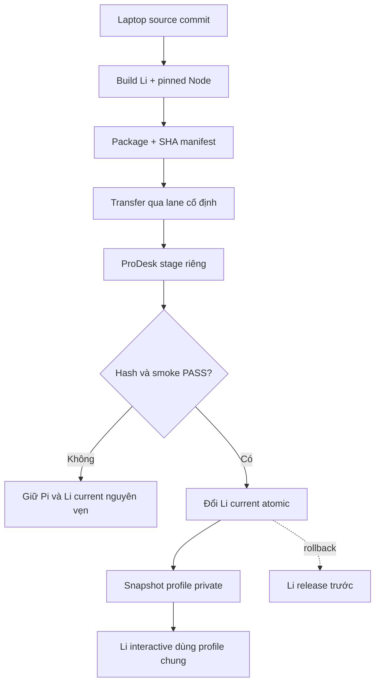

# Spec: Cài Li side-by-side trên ProDesk Linux

## Context Snapshot
- Project / module: Li fork trong `pi-mono-li`, branch `li/stable`, source commit hiện tại `ba4034c30`.
- Stack / runtime: TypeScript/Node.js `>=22.19.0`; ProDesk Ubuntu x86-64; Li package có `piConfig.name = "li"` và cố ý dùng chung `~/.pi/agent` với Pi.
- Current behavior: ProDesk có Pi `0.84.2` tại `~/.local/prodesk-pi/` với versioned releases + `current` symlink. Không có lệnh `li`; Li source chỉ có Windows launcher `bin/li.cmd`. Pi-specific `pi_core_manager.py` hardcode `pi` root/version nên không dùng để cài Li.
- Desired behavior: Có lệnh Li riêng trong user home, cài side-by-side, có release rollback riêng; lệnh `pi`, Pi `0.84.2` và profile đang có không bị thay thế.
- Relevant files to read:
  - `bin/li.cmd` — mapping env và launcher hiện tại.
  - `packages/coding-agent/src/li/runtime-env.ts` — quy tắc alias/conflict của profile.
  - `scripts/build-li.mjs`, `scripts/build-coding-agent-bundle.mjs` — build + external runtime imports.
  - `docs/li-maintenance.md` — Li build, profile và rollback contract.
  - `../python/app_presets/home_server/pi-agent/artifacts/artifact-lock.json` — Node Linux x64 pin `22.19.0`, SHA-256 đã verify.
  - `../agent/pi-agent-parity/plans/pi-core-rollback.md` và `../python/app_presets/home_server/CONTROL_PLANE.md` — ProDesk release/protected-state boundaries.
- Existing constraints:
  - Không thay hoặc ghi vào `~/.local/prodesk-pi`, không đổi lệnh `pi`, không dùng Pi-specific installer/manager cho Li.
  - Chỉ cài user-local; không `sudo`, package manager trên ProDesk, service, port, shell-profile edit hay auto-login.
  - Không copy/đọc/in `auth.json`, `models.json`, session, token hoặc nội dung profile; `.pi` chỉ được snapshot riêng trên ProDesk, không transport.
  - `~/.pi/agent` hiện mode `700`, có 5689 file. Snapshot bắt buộc trước lần Li interactive đầu tiên vì Li dùng chung profile.
  - ProDesk preflight xác nhận `pi` 0.84.2, Node bundle 22.19.0, 102 GB trống, chưa có `li`. `~/.local/bin` không nằm trong PATH của shell preflight; PATH của login shell thật chưa xác nhận, không tự sửa.

## Objective
- Cài một Li runtime có provenance từ commit `ba4034c30` dưới root riêng trong home user `quoc`.
- Mày gọi được Li bằng absolute launcher path; nếu `~/.local/bin` chưa nằm trong PATH thì vẫn không tự sửa shell profile.
- Pi hiện tại và dữ liệu/profile dùng chung còn nguyên; trước lần interactive đầu tiên có snapshot local, private và kiểm chứng được.

## Scope
- In:
  - POSIX launcher tương đương hợp đồng của `bin/li.cmd`.
  - Bundle Linux x64 có Node pin, Li dist/assets và đúng external runtime dependencies; manifest pin source + SHA-256.
  - Installer user-local, staging → validate → atomic `current`, giữ release trước để rollback; chỉ tạo `~/.local/bin/li` symlink khi path chưa tồn tại.
  - Staged CLI smoke với profile tạm, snapshot `.pi` private trước khi mở profile thật, verify Pi không đổi.
  - Cập nhật `docs/li-maintenance.md` với đường build/install/rollback ProDesk.
- Out:
  - Thay/upgrade Pi core, sửa Pi runtime hoặc pin `pi-core-version.json`.
  - Deploy thêm/bớt Pi extensions/skills, đổi Linux allowlist, sync auth/model/session/profile từ laptop.
  - Sửa PATH/shell profile, cài global, `sudo`, systemd/service, package install trên ProDesk.
  - Dùng ProDesk làm nơi build source; laptop Li repo vẫn là canonical.

## Thuật ngữ
- `Li release` = một thư mục versioned riêng dưới `~/.local/prodesk-li/releases/`; không phải Pi release.
- `current` = symlink chỉ đến Li release đang dùng; rollback chỉ đổi symlink của Li.
- `staged smoke` = chạy `li --version`/`li --help` từ staging với profile tạm trước khi expose lệnh; không phải mở profile thật.
- `profile snapshot` = bản sao private của `.pi` nằm trên ProDesk; không rời host và không đưa vào bundle.

## Assumptions
- Cài side-by-side là mặc định đúng: user chỉ yêu cầu cài Li, không yêu cầu thay Pi; Pi core hiện có giữ nguyên.
- Li giữ thiết kế hiện tại là dùng chung `~/.pi/agent`; snapshot bảo vệ lần khởi động đầu, không tạo profile tách rời.
- Node `22.19.0` Linux x64 artifact trong `pi-agent/artifact-lock.json` là nguồn pin có thể tái dùng; không tải binary trên ProDesk.
- Mã `pi-ask`/`pi-terminal-relay` hiện có trên laptop không tự động được deploy theo spec này; extension runtime trên ProDesk giữ nguyên.

## Open Questions
- PATH của login shell thật chưa được xác nhận. Acceptance không phụ thuộc PATH: launcher tuyệt đối `~/.local/prodesk-li/bin/li` phải chạy; installer không sửa shell profile.
- Nếu `~/.local/bin/li` xuất hiện trước lúc cài, installer phải dừng và giữ nguyên file; không đoán owner/path hay ghi đè.

## Approach
- Chọn: thêm POSIX launcher và Li-specific release/install lane dưới `~/.local/prodesk-li`; không dùng Pi core manager vì manager hardcode `pi` path/version.
- Lý do: Pi đang có side-by-side rollback tốt; dùng lại cùng root hoặc đổi `pi` sẽ nhập nhằng phiên bản và có thể làm hỏng runtime đang chạy. Li cần Node Linux x64 cùng bundle riêng; pin SHA rồi validate trong staging mới bật `current`.
- Dependencies chính: clean Li source commit, ProDesk profile snapshot ID lấy trước build, `node scripts/build-li.mjs --offline`, Node 22.19.0 artifact đã pin, external packages đúng với esbuild bundle, fixed transfer path và ProDesk Pi worker.
- Risk lớn nhất: Li lần đầu mở profile chung và có thể chạy migration. Vì vậy installer chỉ smoke bằng profile tạm; snapshot `.pi` private phải PASS trước khi user mở Li interactive.

## Diagram

## Bỏ qua
- Không dùng `npm install -g`, npm download, hay `install-prodesk-pi.sh`: đây không phải Pi package và các lệnh đó không tạo lane rollback Li.
- Không copy toàn bộ `node_modules`; chỉ đưa runtime dependencies được bundle xác định là external và thực sự cần.
- Không thêm Linux launcher bằng cách sửa trực tiếp trên ProDesk; mọi source phải được test/commit từ laptop trước khi deploy.

## Risks
- Bundle thiếu external module/assets → staged `--version`/`--help` fail; staging phải bị bỏ, `current` giữ nguyên.
- Conflict tại `~/.local/bin/li` → dừng, không ghi đè.
- Shared profile snapshot fail hoặc không đủ dung lượng → không chạy Li interactive.
- PATH login không có `~/.local/bin` → dùng absolute launcher path; không sửa profile ngầm.
- Tên `li` không được nhầm với `pi`; smoke phải xác nhận `pi --version` vẫn là `0.84.2` và `~/.local/prodesk-pi/current` không đổi.

## Task List

### Task 1: Thêm Linux launcher có cùng guard như Windows
- Acceptance:
  - `bin/li` set `LI_RUNTIME=1`, `PI_PACKAGE_DIR`, `PI_CORE_CLI_PATH`, `PI_OSC_GUARD_DIST`, `PI_SKIP_VERSION_CHECK` và trỏ Node/CLI trong Li release hiện hành.
  - Map `PI_CODING_AGENT_DIR`/`PI_CODING_AGENT_SESSION_DIR` sang `LI_*` khi chưa có; conflict path phải fail trước chạy CLI.
  - `--version` trả version/source từ receipt; launcher không sửa PATH/profile.
- Reproduce: `node --test scripts/li-launcher.test.mjs`
- Verify: test pass, `npm run check` pass, `git diff --check` pass.
- Status: Focused launcher tests PASS (4/4); executable mode set. Full `npm run check` rerun remains a final gate.
- Files:
  - `bin/li` — pattern: `bin/li.cmd`.
  - `scripts/li-launcher.test.mjs` — pattern: `scripts/*.test.mjs`.
  - `packages/coding-agent/src/li/runtime-env.ts` — reference cho alias/conflict behavior; chỉ sửa nếu test chỉ ra contract thiếu.

### Task 2: Tạo bundle ProDesk có provenance/hash
- Acceptance:
  - Build chỉ từ clean committed Li source; trước build phải có ProDesk snapshot `.pi` private và truyền đúng snapshot ID qua `LI_PROFILE_SNAPSHOT_ID`; receipt ghi commit/version/snapshot ID.
  - Bundle chứa `packages/coding-agent/dist`, package metadata, assets và external modules closure; không chứa auth/settings/session/profile.
  - Node tarball khớp pin SHA-256 `c0649af18e6a24f6fe5535a3e86b341dd49a8e71117c8b68bde973ef834f16f2`.
  - Packer fail nếu source dirty, external import thiếu, archive/hash mismatch hoặc output ghi đè artifact có sẵn.
- Reproduce: đặt `LI_PROFILE_SNAPSHOT_ID` bằng ID trong ProDesk snapshot receipt, rồi chạy `node scripts/build-li.mjs --offline && node scripts/package-prodesk-li.mjs --output packages/coding-agent/dist/prodesk-li-release`.
- Verify: packer tự verify manifest/archive; `node --test scripts/package-prodesk-li.test.mjs`; `npm run check` pass.
- Status: PASS. Bundle v3 build từ clean commit `b0d59811f` với `LI_PROFILE_SNAPSHOT_ID=prodesk-li-pre-first-run-20261022-eb14ef88a-rsync`; packer tests PASS, `npm run check` PASS, round-trip lock↔archive xác nhận tay PASS; round-trip check đã được thêm vào packer (HEAD `0618a6c67`, packer-only, không đổi runtime tree).
- Files:
  - `scripts/package-prodesk-li.mjs` — pattern: `scripts/build-li.mjs` và `scripts/build-coding-agent-bundle.mjs`.
  - `scripts/package-prodesk-li.test.mjs` — pattern: `scripts/*.test.mjs`.

### Task 3: Cài side-by-side qua staging và current pointer riêng
- Acceptance:
  - Installer refuse root, thiếu `--yes`, sai SHA, sai source/version, target symlink/conflict hoặc thiếu external runtime.
  - Install dưới `~/.local/prodesk-li/`; staging validate trước, `current` đổi atomic sau khi `li --version`/`li --help` pass với profile tạm.
  - Tạo `~/.local/prodesk-li/bin/li`; chỉ tạo `~/.local/bin/li` symlink nếu chưa tồn tại; không sửa shell profile.
  - Pi wrapper/version/current, TelePi/service, và `.pi` profile không đổi trong install/smoke.
  - Giữ release rollback; lỗi trước promote không đổi Li `current`.
- Reproduce: `node --test scripts/install-prodesk-li.test.mjs`
- Verify: fixture test staging/rollback/conflict; `npm run check`; trên ProDesk chạy readiness trước apply, rồi kiểm checksum/version/current sau apply.
- Status: PASS. Fixture install/rollback/conflict 4/4 trên ProDesk Linux temp HOME sau hai fix: fixture receipt phải pretty-print, và installer tree-hash phải sort theo path (không phải full-string `path:digest`).
- Files:
  - `scripts/install-prodesk-li.sh` — pattern: `../python/app_presets/home_server/pi-agent/install-prodesk-pi.sh`; không copy các Pi-specific constant/root.
  - `scripts/install-prodesk-li.test.mjs` — test POSIX installer bằng fixture/temp home.
  - `docs/li-maintenance.md` — cập nhật runtime map, build, install và rollback.

### Task 4: ProDesk install và profile safety gate
- Acceptance:
  - Dùng fixed laptop→ProDesk transfer + ProDesk Pi lane; không generic SSH/raw shell, không build source trên ProDesk.
  - ProDesk chạy `verification/scripts/install-prodesk-li.test.mjs` trên Node Linux với temp HOME: fixture install/rollback pass, Pi production/profile không bị đụng.
  - Trước apply, ProDesk verify source commit + archive hash; staged Li version/help pass với profile tạm.
  - Snapshot `.pi` được tạo local-only ngay trước final build dưới `~/.local/state/prodesk-li/profile-snapshots/<snapshot-id>/`; dùng rsync checksum vào staging, regular-file/symlink counts phải khớp; dry-run chỉ được có socket-skip và directory-mtime code `.d..t......`, mọi file-content/link delta phải hết rồi mới tar staging. Directory `0700`, `profile.tar.gz` + `snapshot.json` `0600`. Receipt ghi ID, source `.pi`, count và archive SHA-256; ID phải khớp build receipt và snapshot còn hợp lệ ngay trước first Li interactive.
  - Chỉ sau snapshot PASS mới cho phép user mở Li interactive với profile chung; chỉ báo PASS/file count/size/hash-match status, không in file names hoặc hashes nhạy cảm.
  - `pi --version` vẫn `0.84.2`; Pi `current` symlink không đổi; Li current trỏ đúng release mới; rollback Li không ảnh hưởng Pi.
- Reproduce: `py -3.13 ..\python\quoc.py --toolkit-search "fixed ProDesk file transfer"` rồi theo đúng capability/lane đã được project policy duyệt; remote verification dùng `prodesk_pi`/fixed ProDesk tooling.
- Verify: ProDesk fixture test PASS; receipt có `source_commit`, bundle SHA, Li version, Pi version/current unchanged, staged smoke PASS, snapshot PASS, rollback pointer test PASS.
- Status: PASS (install + verify). Snapshot rsync PASS: `~/.local/state/prodesk-li/profile-snapshots/prodesk-li-pre-first-run-20261022-eb14ef88a-rsync/` (dir 0700, archive+receipt 0600, 5754 files, hash match). Bundle v3 transfer qua scp key-only `prodesk-home`, hash khớp lock. Fixture PASS → readiness PASS → install PASS: Li `1.3.0 (source b0d59811fe)`, `~/.local/prodesk-li/current` → release b0d59811fe, `~/.local/bin/li` tạo mới, Pi `0.84.2` + Pi current unchanged, snapshot hash vẫn match sau install. Còn lại: user mở Li interactive (User Test) rồi mới archive spec.
- Files:
  - `docs/li-maintenance.md` — runtime path/rollback contract.
  - ProDesk release receipt nằm ngoài repo, không chứa credential/hash nội dung profile.

## Checkpoints
- Sau Task 1: launcher parity tests + root check PASS.
- Sau Task 2: bundle reproducible/hash-verified, no secrets/profile data.
- Trước final build: snapshot `.pi` private PASS, ID ghi vào Li build receipt.
- Trước ProDesk apply: readiness + transport hash PASS; snapshot ID/backup còn hợp lệ; chưa đạt thì không chạy Li profile.
- Trước DONE: Li version/help, Pi unchanged, snapshot PASS, rollback pointer test và User Test đều PASS.

## External Review Brief
### Reviewer cần phán
- Side-by-side release có thực sự không chạm Pi core/profile trong install và staged smoke không?
- POSIX launcher có giữ đủ Windows wrapper invariants mà không tự sửa shell config?
- Package builder có chốt external import closure, Node pin và fail closed khi source dirty/hash sai không?
- Installer staging/current/rollback có bảo toàn Pi và Li release trước khi lỗi không?
- Snapshot scope, permission và output có tránh rò credential/session không?

### Reviewer nên đọc trước
- `bin/li.cmd`, `packages/coding-agent/src/li/runtime-env.ts`, `scripts/build-li.mjs`, `scripts/build-coding-agent-bundle.mjs`, `docs/li-maintenance.md`.
- `../agent/pi-agent-parity/plans/pi-core-rollback.md`, `../python/app_presets/home_server/pi-agent/install-prodesk-pi.sh`, `../python/app_presets/home_server/CONTROL_PLANE.md`.

### Reviewer không cần phán
- UI localization Tasks 1–5 đã UAT/verify/archive ở `SPEC-2026-10-22-li-ui-language-toggle`; không review lại copy.
- Pi T20 canary/upgrade hoặc deploy extension allowlist; đều ngoài scope.

## User Test
| Hành động | Kết quả kỳ vọng | Chuẩn nhìn |
|---|---|---|
| Chạy `~/.local/prodesk-li/bin/li --version` | In Li version + source `ba4034c30` | Không mở Pi TUI, không prompt login |
| Mở Li interactive sau khi snapshot PASS | Li TUI mở với shared profile hiện có | Pi vẫn gọi bằng `pi` và còn version `0.84.2` |
| Thử `~/.local/bin/li` nếu symlink được tạo | Chạy cùng Li release | Nếu PATH thiếu `~/.local/bin`, absolute path vẫn dùng được; không profile edit |

## Completion Gates
- [ ] Linux launcher tests và `npm run check` PASS.
- [ ] Clean-source bundle + pinned Node/external deps hash PASS; artifact không chứa profile/secret.
- [ ] Staged install/smoke/atomic pointer + rollback fixture tests PASS.
- [ ] ProDesk isolated installer/rollback fixture tests PASS; snapshot PASS trước interactive Li; Li install receipt đã ghi, Pi `0.84.2`/current unchanged.
- [ ] User Test PASS; `spec-check` PASS sau khi archive spec.
