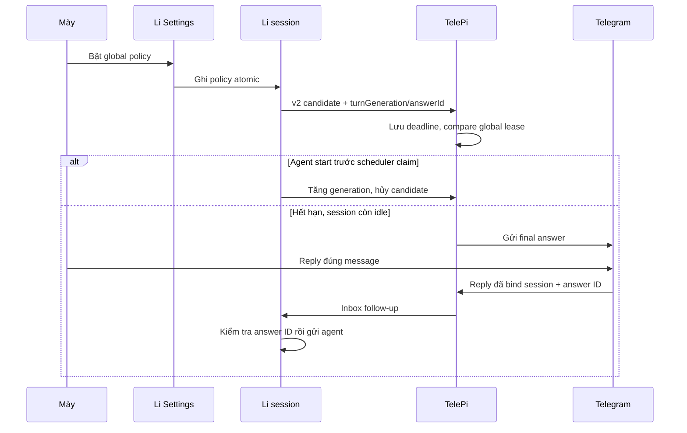
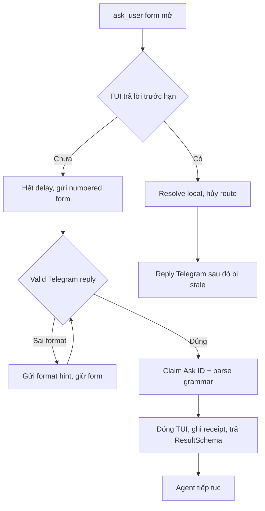
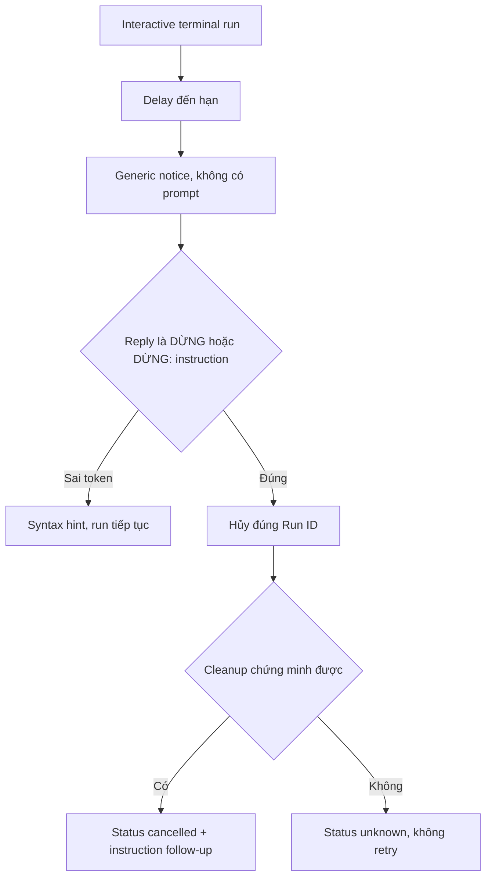

# Spec: Telegram follow-up cho session Li đang idle

## Context Snapshot
- Project / module: Li TUI (`D:/pcloud/workspace/code/pi-mono-li`) và integration local với source-managed Pi extensions + TelePi Windows bridge.
- Supersedes: —
- Stack / runtime: Li TypeScript/npm workspace, Node >=22.19; Pi extensions TypeScript source ở `D:/pcloud/workspace/code/python/app_presets/pi/extensions`; TelePi TypeScript/Vitest ở `D:/pcloud/workspace/code/ai/pi-telegram-bridge`.
- Revisions đã khảo sát: Li `li/stable` @ `a01335a912467fb95833ccf433dcfda0ec55d840`; Python source repo @ `ef172baea606b72a1e8e36dc7d599ba1f4f3c413`; TelePi `main` @ `8c31fa946f7f95cc3a71cdcf36427fd66c40a22a`.
- Current behavior:
  - `tele-supervisor` lưu event/lease/reply inbox theo `sessionKey` dưới `%APPDATA%\telepi\supervisor`; `/tele on` là per-session, gửi settled answer ngay; Telegram reply chỉ được inject khi session idle.
  - TelePi poll mailbox mỗi giây, lưu v1 route/delivery theo Telegram message ID và v1 lease theo `sessionKey`; `disarmed/offline` hiện xóa route và `/tele off` ghi lease `off`. Event lỗi giữa các chunk hiện được replay cả event vì outbox chỉ chuyển `processed` sau khi send hoàn tất.
  - `pi-ask` mở `ctx.ui.custom` và chờ local form submit/cancel hoặc timeout 30 phút. Telegram reply hiện tại không thể hoàn thành form đang block.
  - `pi-terminal-relay` chạy interactive command trong visible pane; password/console input phải nhập tại pane. `/run stop` hiện hủy mọi approval/run controller của session, không phải đúng một run.
  - Li có `/settings` với các hàng Li-only; Pi và Li chia sẻ `.pi/agent`. Các session Li là process riêng nên SettingsManager của một process không tự refresh cache ở process khác.
- Desired behavior: một global opt-in trong Li Settings điều khiển mọi session Li đang mở trên laptop; hệ thống tự gửi final answer sau delay nếu session không có lượt mới; gửi câu hỏi `ask_user` sau delay và nhận câu trả lời Telegram vào đúng form; cảnh báo terminal interactive và chỉ hủy run khi owner explicit yêu cầu.
- Relevant files to read:
  - Li: `packages/coding-agent/src/modes/interactive/components/settings-selector.ts`, `settings-submenu.ts`, `interactive-mode.ts`, `locale.ts`, `core/settings-manager.ts`, `packages/tui/src/components/settings-list.ts`, `docs/li-maintenance.md`.
  - Extension source: `tele-supervisor/{index.ts,protocol.ts,state.ts}`, `super-parent/protocol.ts` (existing `redactSensitiveText()`), `pi-ask/{index.ts,component.ts,schema.ts}`, `pi-terminal-relay/{index.ts,execution.ts,ledger.ts,local-visible-runner.ts,visible-wait.ts}`.
  - TelePi: `src/bot/supervisor-mailbox.ts`, `src/bot.ts`, `src/paths.ts`, `docs/windows-workflow.md`, `test/bot/supervisor-mailbox.test.ts`.
  - Reference spec: `docs/specs/SPEC-2026-10-22-li-ui-language-toggle/SPEC.md`.
- Existing constraints:
  - Feature mới chỉ chạy khi `LI_RUNTIME=1`; Pi thường và extension behavior hiện có không đổi.
  - Không gọi tool từ agent để tự gửi; lifecycle hook + local mailbox là authority.
  - Không chỉnh raw session JSONL, không đưa token/password/command/output nhạy cảm vào Telegram hoặc log.
  - Không mở cùng session file trong Pi và Li cùng lúc.
  - Li repo rule: không commit nếu owner chưa yêu cầu; build/verify theo `docs/li-maintenance.md`.
  - Python repo hiện ở `t1-ep-launch-safety-wip` và có file untracked riêng `docs/specs/.working/SPEC-2026-11-09-pi-share-clip.md`; implementation không được sửa/xóa file đó hoặc tự chuyển branch.
  - TelePi Windows log hiện tại nằm dưới `%LOCALAPPDATA%\telepi\logs`; toolkit có `--pi-telegram-logs`.

## Objective
- Khi mày rời laptop, Li tự chuyển đúng câu trả lời/câu hỏi đang chờ sang Telegram; reply quay về đúng session đang mở, không bắt agent tự gọi tool.
- Terminal cần nhập liệu local vẫn giữ secret ở visible pane; Telegram chỉ giúp mày báo agent dừng run cụ thể và tiếp tục phần việc khác nếu có thể.
- Không gửi bù câu trả lời đã xong trước khi bật, không gửi trùng, không làm Pi thường đổi hành vi.

## Scope
- In:
  - Một global Li Settings submenu, mặc định `Off`; mọi session Li cùng supervisor root đọc chung policy ngay khi đổi, không restart Pi/Li.
  - Delay có thể chỉnh: final answer mặc định 10 phút; `ask_user` mặc định 5 phút; terminal interactive notice mặc định 5 phút. Có giá trị `Off` cho từng kênh để giữ một master switch mà vẫn tắt riêng reminder không cần.
  - Final-answer candidate chỉ cho assistant stop bình thường, có text; hủy khi cùng session bắt đầu lượt mới; gửi tối đa một lần cho một answer ID.
  - Telegram reply từ final-answer message quay về đúng session và bị từ chối nếu answer/session đã stale.
  - `ask_user` Telegram answer bằng text đánh số; first valid submission wins giữa TUI và Telegram; submit remote phải đóng form TUI và trả `ResultSchema` cho agent.
  - Terminal notice chỉ chứa trạng thái chung; reply explicit `DỪNG` hủy đúng interactive run ID, rồi chuyển phần chỉ dẫn còn lại cho agent sau khi tool trả kết quả.
  - Delivery state/logging có mã lỗi hữu ích và không chứa token, answer body, câu hỏi, command hay password.
- Out:
  - Pi thường, ProDesk agent-control, `terminal_request` target `prodesk-home`, Zalo, `/handoff` và session đã đóng.
  - Backfill final answer cũ khi bật setting.
  - Remote shell input/execution; gửi raw `terminal_request` command, prompt, stdout/stderr hoặc credential qua Telegram.
  - Pause rồi resume nguyên tiến trình terminal; chỉ hỗ trợ hủy run exact ID, không rollback side effect.
  - Telegram image/note attachment cho `ask_user`; các chức năng này tiếp tục dùng tại TUI.
  - Inline keyboard; bản đầu dùng text reply có định dạng ổn định.
  - Thay đổi semantics hiện tại của `/tele on/off`: lệnh đó vẫn là immediate per-session mirror.

## Thuật ngữ
- `Global policy` = file local duy nhất mà Li Settings, active Li sessions và TelePi cùng đọc/ghi; không phải project setting; `revision` là counter tăng đơn điệu sau mỗi lần commit.
- `Supervisor root` = `%APPDATA%\telepi\supervisor` trên Windows, trừ khi `TELEPI_SUPERVISOR_DIR` override; chứa mailbox hiện có, không chứa bot token.
- `Global lease` = lease riêng `leases/global-<sessionKey>.json`, tách khỏi v1 `/tele` lease; chứa `phase`, `turnGeneration`, `currentAnswerId`, optional `activeAskId`/`activeRunId`/`interactiveRun`, `updatedAt` và label, không chứa answer text.
- `Global route` = `routes/global-<sessionKey>.json`; v1 `routes/<sessionKey>.json` giữ nguyên. V2 delivery record mang lane để `routeReply` chọn lease/route đúng; v1 `disarmed/offline` không xóa global route.
- `Protocol v2` = event `version: 2` với namespace/type mới; v1 `/tele` events/inbox giữ nguyên schema và semantics.
- `Session key` = khóa đã hash từ path của session file; dùng để route, không ghi raw path ra notification/log.
- `Answer ID` = ID của assistant message vừa settle; dùng để hủy notification cũ và chặn reply rơi vào lượt mới.
- `Ask ID` = ID riêng của một lần gọi `ask_user`; mỗi câu trả lời Telegram phải khớp form còn mở.
- `Run ID` = ID của một lần `terminal_request`; remote cancel chỉ được tác động lên đúng run này.
- `Explicit terminal cancel` = reply sau trim + Unicode NFC đúng bằng `DỪNG`, hoặc bắt đầu bằng `DỪNG: ` + non-empty instruction; token case-sensitive, giữ dấu, ASCII colon, không dịch theo locale. Text suffix chỉ là instruction follow-up, không phải shell input.
- `Unknown delivery` = Telegram có thể đã nhận request nhưng TelePi không nhận được kết quả xác nhận; không tự gửi lại để tránh duplicate.
- `Dynamic Telegram text` = session label, final answer, câu hỏi và option label lấy từ runtime; phải đi qua safe renderer/escaping tại insertion point.

## UX Baseline
1. Keyboard: hàng `Telegram follow-up` mở submenu có title; các delay mở `SelectSubmenu` bằng arrows/Enter/Esc, không cycle một chiều qua `values`.
2. Focus: sau khi đổi toggle/delay, focus giữ ở đúng hàng; submenu đóng về đúng hàng Telegram follow-up.
3. A11y: TUI không có DOM/ARIA; submenu ghi master On/Off bằng chữ; dấu `+`/`-` ở hàng cha được giải nghĩa trong description; status text (`Ready`, `Err <code>` với code ≤12 cells, `Unknown`, `No bridge`) đọc được, không chỉ đổi màu. Chi tiết lỗi xem qua `/tele status`.
4. Viewport: contract 40×24/80×24 áp cho hàng mới và submenu mới, không hứa sửa layout settings cũ. Label hàng cha ≤32 cells và giá trị cha là `+`/`-` (1 cell); description giải nghĩa, submenu hiện On/Off thành chữ; label trong submenu ≤15 cells, delay dạng `10m`, status code ≤12 cells; description/hint mới tối đa một dòng ở 40 cột và không che 5 hàng.
5. States: Off mặc định; On; policy file lỗi/không đọc được; TelePi unavailable; notification scheduled/sent/failed/unknown; terminal run stale/unknown.
6. Nhất quán: tái dùng `SettingsSelector`, submenu và theme hiện có; không thêm border/chrome hay visual system mới.
7. Platform: keyboard-first TUI; touch target N/A; Pi không thấy hàng Li.
8. Copy: English và Vietnamese theo `Li UI locale`; terminal alert không dùng chữ “đang chờ password” vì hệ thống không chứng minh được prompt cụ thể.

## Assumptions
1. Toàn bộ Li sessions mục tiêu dùng chung một supervisor root trên laptop; nhiều root khác nhau là các installation độc lập.
2. Li Settings là front door của global policy; policy được lưu atomic trong `global-policy.json` dưới supervisor root để mọi process thấy ngay, không dựa vào SettingsManager cache. Không tạo bản copy thứ hai trong project `.pi/settings.json`.
3. Mở setting lên `On` chỉ theo dõi lượt settle mới sau thời điểm bật; session đang idle không phát lại answer cuối cũ.
4. Delay là wall-clock. Nếu TelePi/laptop ngủ hoặc offline, scheduler xử lý sau khi tỉnh lại, nhưng chỉ gửi nếu session còn live và candidate vẫn là answer mới nhất.
5. Terminal notice sau 5 phút nghĩa là “interactive run còn active, có thể cần laptop”, không khẳng định chắc chắn runner đang chờ input.
6. Remote `ask_user` trả answers theo schema hiện tại; `notes` và ảnh là local-TUI-only.
7. Khi `terminal_request` bị hủy, agent không tự retry; nếu cleanup không chứng minh được, giữ `unknown`/lease barrier theo terminal-relay contract.

## Open Questions
- Không còn blocker cho working spec. Terminal notice delay 5 phút là default đề xuất và chỉnh được trong Li Settings.

## Approach
- Chọn: một policy local atomic dưới supervisor root, một durable scheduler trong TelePi hiện có và các event typed từ Li extensions. Không tạo daemon mới, không dùng timer thuần trong từng process.
- Li Settings quản lý `enabled`, `finalAnswerDelayMinutes`, `askUserDelayMinutes`, `terminalNoticeDelayMinutes`. Ghi dùng cross-process lock + compare/re-read để tránh mất cập nhật; mỗi commit tăng `revision`. Thiếu/hỏng policy ⇒ fail closed về Off và ghi lỗi an toàn.
- Mỗi active Li session refresh policy từ canonical supervisor root tối đa mỗi 1 giây; Settings submenu đang mở cũng refresh trong cùng bound. Không tin snapshot `ctx.getSettings()` process-local; path mismatch/read error ⇒ fail closed. `LI_RUNTIME` là gate để Pi thường không phát event mới.
- TelePi nhận event có `sessionKey` + ID cụ thể, ghi schedule/delivery bền, hủy theo activity event và re-check policy, lease, answer/form/run ID ngay trước send/action.
- `/tele on` giữ immediate mirror. Nếu session đó đã armed, bỏ delayed final candidate để không gửi trùng. Global lane có lease, route và delivery record riêng: `/tele off` chỉ đặt v1 lease Off/xóa v1 route, không đụng global lease/route; per-session state không bật/tắt global follow-up.
- Final answer sau 10 phút: chỉ phát nếu `turnGeneration` và `answerId` của candidate còn khớp global lease, phase `waiting`, session còn live và policy còn On. Agent start tăng generation ngay; nếu scheduler claim trước thì message có thể đã gửi, nhưng reply vẫn compare-and-set generation trước khi enqueue.
- `ask_user` sau 5 phút: TelePi gửi numbered questions/options. Reply Telegram được parse xác định, không dùng model để đoán mapping. Valid local submit hoặc remote submit đầu tiên thắng; bên đến sau bị stale.
- Terminal sau 5 phút interactive run: gửi generic alert không có prompt/output. Chỉ reply bắt đầu bằng `DỪNG` mới phát terminal-cancel exact `runId`; terminal relay abort controller/pane hiện hành và sau tool result mới chuyển instruction còn lại thành follow-up.
- Delivery state per notification/chunk: `pending → sending → sent`, `failed` cho lỗi chắc chắn không gửi được, `unknown` khi kết quả request mơ hồ. Claim độc quyền; restart gặp chunk `sending` không có Telegram message ID ⇒ `unknown`, không gửi lại (at-most-once, không hứa exactly-once). 429/parse rejection chỉ retry theo rule tường minh; log và `/tele status` không chứa body.
- Lý do: supervisor mailbox đã định danh session, giữ lease và route reply; đặt scheduler ở TelePi cho phép timer sống qua restart mà không thêm process. Sidecar policy là một source global duy nhất để các session đang mở phản ứng ngay.

## Diagram







## Bỏ qua
- Không đổi `/tele on/off` thành global hoặc delay mặc định; người dùng đang dùng `/tele on` vẫn nhận immediate mirror.
- Không chuyển raw tool payload/output, thinking, error stack, session path hoặc terminal command/prompt/stdout/stderr thành notification; chỉ gửi assistant final text đã sanitize.
- Không dùng LLM để parse Telegram answer thành lựa chọn; parser phải deterministic.
- Không hủy terminal run chỉ vì đã quá 5 phút; chỉ explicit `DỪNG` từ alert gắn đúng run mới được hủy.
- Không tạo thêm service/daemon; không dùng outbound webhook/cloud queue; mailbox và scheduler ở local TelePi.
- Không tự động retry khi Telegram send có thể đã thành công; tránh duplicate chunk/notification.

## Risks
- Li Settings, extension và TelePi có thể lệch supervisor root nếu `TELEPI_SUPERVISOR_DIR` override không đồng nhất; global lease cũng phải nằm riêng v1 lease. Mismatch ⇒ fail closed, không fallback sang per-session route.
- Mixed-version: TelePi cũ quarantine `version: 2` vào `rejected/`; nếu extension update trước TelePi, event có thể bị drop. Upgrade TelePi trước; rollback chỉ khi global Off và mọi Li v2 writer đã dừng.
- Local TUI submit và Telegram reply có thể đua nhau; `Ask ID` cần atomic first-wins, late event phải báo stale và không thành generic prompt.
- TUI có thể đã đi sang lượt khác trước khi người dùng reply final Telegram message; `Answer ID` fence phải ngăn message rơi vào task mới.
- Hủy terminal run có thể xảy ra sau partial side effect; result `unknown` giữ terminal lease và tuyệt đối không auto-retry.
- Telegram có thể nhận chunk rồi TelePi crash trước khi lưu message ID; không thể đảm bảo exactly-once. Chọn at-most-once: ambiguous chunk thành `unknown`, không resend tự động; owner có thể phải kiểm tra Telegram thủ công.
- Pattern redaction chỉ nhận diện assignment/Bearer/known token prefixes/credentialed URL đã liệt kê; không chứng minh free prose không có secret lạ. Không gửi prompt/tool/terminal output; pattern hit thì redact final text, suppress remote form, hoặc drop terminal suffix; redactor lỗi thì fail closed. Owner không nhập credential vào prompt/reply Telegram.
- V2 inbox claim at-most-once: nếu extension crash sau claim nhưng trước form resolve thì không được ack `applied`; owner chỉ gửi lại nếu Ask ID vẫn mở. V1 `/tele` delivery giữ retention/fallthrough behavior hiện tại (reply sau TTL không thuộc guarantee V2). Laptop ngủ/offline thì không đảm bảo đúng giờ; scheduler catch up khi máy hoạt động và candidate/lease vẫn hợp lệ.

## Task List

### Task 1: Policy local + Li Settings
- Acceptance:
  - Một hàng Li-only `Telegram follow-up` (label ≤32 cells) mở submenu có title; value hàng cha dùng token ASCII 1-cell `+` (enabled) / `-` (disabled), locale-neutral, và localized description giải nghĩa dấu. Master row description trước khi bật phải nói EN/VI: chỉ assistant final/question đã sanitize được gửi, không gửi tool/terminal output; secret filter là pattern-based, không tuyệt đối, đừng nhập credential. Trong submenu, master mặc định Off và hiển thị full localized On/Off; ba delay (`Final`, `Ask-user`, `Terminal`) là các row mở `SelectSubmenu` có up/down/Enter/Esc, không cycle một chiều bằng `values`. Default lần lượt 10m/5m/5m; preset từng kênh gồm `Off` và 1/3/5/10/15/30/60m; label trong submenu ≤15 cells.
  - Policy được lưu atomic trong supervisor root; cross-process lock/CAS tránh lost update và `revision` tăng đơn điệu; missing file trả defaults Off; malformed/version lạ fail closed và tạo diagnostic không chứa nội dung/token. Chuyển master Off→On chỉ được commit nếu `global-status.json` báo protocol v2 và heartbeat ≤45 giây; nếu không, giữ Off và báo `No bridge`.
  - Li Settings đọc policy khi mở và refresh khi submenu đang mở; mọi active Li session thấy thay đổi trong ≤1 giây, không cần restart. Resolver dùng cùng supervisor-root algorithm/override với TelePi; mismatch/read failure fail closed.
  - Hàng/submenu chỉ tồn tại dưới Li (`APP_NAME === "li"`); Pi settings và `settings.json` không đổi.
  - EN/VI copy có key parity; submenu có read-only status row cuối với giá trị gọn `Ready`/`Err <code>` (code ≤12 cells)/`Unknown`/`No bridge`; `No bridge` nếu global-status heartbeat stale >45 giây; chi tiết xem `/tele status`.
- UX Contract:
  - Pre-lock rút gọn vì đây là một submenu TUI trong Settings có sẵn, không tạo surface hay visual world mới.
  - Journey: `/settings` → chọn hàng `Telegram follow-up` → trong submenu đổi master hoặc chọn delay qua titled `SelectSubmenu` → Back về hàng cha với master state mới nhất.
  - States: file absent = Off/defaults; enabled = On; invalid/unavailable = Off + status error có recovery; bridge/delivery status hiển thị ở row cuối; khi disable channel thì delay hiển thị `Off`.
  - Keyboard: master toggle một thao tác trong submenu; delay chọn bằng `SelectSubmenu` với up/down/Enter/Esc; status row read-only, Enter/Space không đổi gì và description dẫn tới `/tele status`; mọi exit path gọi `done(masterEnabled ? "+" : "-")` để row cha không giữ state cũ.
  - 40×24 và 80×24: row cha giữ `+`/`-` nguyên vẹn; security description tối đa 2 dòng, các description/hint còn lại ≤1 dòng; submenu có title, năm row gọn và status trong 24 dòng; test tại cả EN/VI.
  - Tái dùng TUI theme/spacing/copy EN/VI; không thêm icon/border/màu mới.
- Skills: `ui-design`, `flow`, `pi-build-extension`.
- Visual Ref: `settings-selector.ts` — Li-only row `liLanguage`; `settings-submenu.ts` — titled `SelectSubmenu`; `settings-list.ts` — width/cancel contract. Không có visual redesign.
- Reproduce:

```
cd D:/pcloud/workspace/code/pi-mono-li
npm run check
cd packages/coding-agent
node "$(git rev-parse --show-toplevel)/node_modules/vitest/dist/cli.js" --run test/settings-selector.test.ts test/li-telegram-follow-up-policy.test.ts
```

- Verify: unit test defaults/invalid config/atomic revision/delay bounds; enable bị block khi bridge thiếu/cũ/stale; parent token `+`/`-` và security description đọc đủ tại width 40; submenu master On/Off đầy đủ; nested navigation + Esc refreshes parent row; one-way `values` cycle không dùng cho delays; status row; two independent readers thấy update trong ≤1s; root default/override parity; 40×24/80×24 EN/VI; Pi không render/use policy; `npm run check` PASS.
- Files:
  - Li repo `packages/coding-agent/src/modes/interactive/components/settings-selector.ts` — pattern `liLanguage` row và submenu.
  - Li repo `packages/coding-agent/src/modes/interactive/interactive-mode.ts` — pattern truyền config/callback Li-only.
  - Li repo `packages/coding-agent/src/modes/interactive/locale.ts` — catalog EN/VI cho settings row.
  - Li repo `packages/coding-agent/src/modes/interactive/telegram-follow-up-policy.ts` (mới) — shared policy path/schema, atomic read/write, default/fail-closed/revision.
  - Li repo `packages/coding-agent/src/modes/interactive/components/settings-selector.ts` — titled feature submenu; per-delay `SelectSubmenu` and parent display-token refresh on every close path.
  - Li repo `packages/coding-agent/test/settings-selector.test.ts` — pattern chọn hàng/callback.
  - Li repo `packages/coding-agent/test/li-telegram-follow-up-policy.test.ts` (mới) — schema, persistence, two-reader change, malformed config.

### Task 2: Session events, leases và cancellation fences
- Acceptance:
  - Active Li session chỉ phát global protocol v2 events (`version: 2`, typed namespace) khi `LI_RUNTIME === "1"`, global policy bật và persistent `global-status.json` xác nhận protocol v2; TelePi offline tạm thời vẫn nhận event vào outbox để catch up. Thiếu marker/version cũ thì không emit v2. Pi thường chỉ giữ v1 behavior, không phát event global mới.
  - Final candidate chỉ được tạo lúc assistant settle với `stopReason === "stop"` và text không rỗng, nếu session idle/không pending user message; delay đếm từ `settledAt`. Event gồm `sessionKey`, `answerId`, `turnGeneration`, event ID, `settledAt`/`dueAt` và policy revision; không có raw session path.
  - `agent_start`/user turn mới tăng `turnGeneration`, cập nhật global lease `phase=working` và hủy candidate trước đó; heartbeat chỉ đặt `phase=waiting` khi `ctx.isIdle()` và không có pending user message; `/tele on` immediate mode không tạo duplicate delayed candidate.
  - Mọi active Li session ghi global liveness lease metadata-only mỗi ≤15 giây (fresh ≤45 giây), kể cả khi policy Off; Off không tạo candidate/outbound. Lease v2 dùng file `leases/global-<sessionKey>.json`, tách v1 lease, chứa `phase`, `turnGeneration`, `currentAnswerId`, active Ask/Run IDs và interactive flag. Các writers merge/CAS dưới cùng cross-process lock để heartbeat không xóa ID do tool handler ghi. `/tele off` chỉ ghi v1 lease `off`, không sửa global lease hay global route.
  - `ask_user` pending event có `askId`, questions/options cần thiết; trước khi publish, `pi-ask` set `activeAskId` trong global lease; local submit/cancel/timeout clear ID và đóng remote route. `ask_answer` là v2 typed event được active handler xử lý khi agent còn bận; claim/receipt at-most-once và idempotent.
  - Interactive terminal event có `runId`, session key, interactive state và timestamp; `pi-terminal-relay` set/clear `activeRunId` + `interactiveRun` trong global lease. Không đưa command, stdout/stderr hoặc prompt text vào event. `terminal_cancel` là v2 typed event được xử lý out-of-band khi tool đang bận nhưng chỉ nếu run/session ID còn khớp.
  - Generic Telegram follow-up vẫn chờ session idle; typed v2 `ask_answer`/`terminal_cancel` dùng shared control poller interval ≤1.000 ms và được dispatch ở tick kế tiếp dù tool đang bận. V1 `disarmed/offline` không đóng global lease.
  - Legacy v1 `armed/online/settled/disarmed/offline` event và v1 lease giữ behavior hiện tại; global lane không ghi đè/chuyển phase v1.
- UX Contract:
  - Không có UI mới trong task này; mở rộng Li TUI `/tele status` hiện có để báo v1 armed/off + global On/Off/delay/bridge/last-delivery status. Không thêm Telegram command mới.
  - Event chỉ được tạo từ system lifecycle; agent không được gọi tool để kích hoạt notification.
- Skills: `pi-build-extension`, `test`.
- Reproduce:

```
cd D:/pcloud/workspace/code/python/app_presets/pi/extensions
node --experimental-strip-types --test tele-supervisor/protocol.test.ts tele-supervisor/index.test.ts tele-supervisor/global-lane.test.ts
```

- Verify: fake session events cho Li/Pi, toggle on/off và restart; fake-timer xác nhận control poll interval không quá 1.000 ms và event được xử lý tick kế tiếp khi busy; test hai lease lanes riêng, candidate cancel + generation update ở hai thứ tự cạnh tranh, stale heartbeat, v1 `disarmed` không xóa v2 route, no raw path/secret/content trong terminal metadata; mixed-version fixture xác nhận v1 behavior giữ nguyên.
- Files:
  - Python repo `app_presets/pi/extensions/tele-supervisor/protocol.ts` — pattern atomic JSON, event schema, v1 claim inbox; thêm v2 event/lease helpers.
  - Python repo `app_presets/pi/extensions/tele-supervisor/global-lane.ts` (mới) — global lease file riêng, generation, active IDs và heartbeat.
  - Python repo `app_presets/pi/extensions/tele-supervisor/index.ts` — `agent_start`, `agent_settled`, `session_shutdown`, `drainInbox` và existing Li `/tele status` command.
  - Python repo `app_presets/pi/extensions/tele-supervisor/state.ts` — giữ per-session `/tele` state tách khỏi global policy/lease.
  - Python repo `app_presets/pi/extensions/tele-supervisor/index.test.ts`, `protocol.test.ts` và `global-lane.test.ts` (mới) — lifecycle/v1 compatibility, generation fence, lane isolation.

### Task 3: Durable TelePi scheduler, Telegram delivery và diagnostics
- Acceptance:
  - V2 events dùng `version: 2` và tách hướng: extension→TelePi outbox gồm `followup_candidate`, `followup_cancel`, `ask_pending`, `terminal_notice`; TelePi→extension inbox gồm `followup_reply`, `ask_answer`, `terminal_cancel`. TelePi mới vẫn nhận toàn bộ v1 immediate events. TelePi cũ quarantine v2 vào `rejected/` mà không crash; deployment bắt buộc update/restart TelePi trước extensions, giữ global Off tới khi xong.
  - TelePi v2 startup/heartbeat ghi `global-status.json` (`protocolVersion: 2`, `updatedAt`, delivery summary), không ghi content. Pending final/ask/terminal schedules persist qua restart; event ID dedupe; due time từ timestamp event + configured delay; scheduler poll/wake ≤1 giây, delivery bắt đầu ở tick kế tiếp nếu lease/policy hợp lệ. Deadline và delivery state không phụ thuộc process timer còn sống. Một cross-process exclusive claim/lock ngăn hai TelePi poller cùng gửi.
  - Trước dispatch scheduler xử lý outbox events đã được ghi trước thời điểm due, rồi kiểm global lease còn fresh (≤45 giây), global policy revision và typed active ID: final candidate cần phase `waiting` + generation/answer ID khớp; ask cần `activeAskId` khớp; terminal notice cần `activeRunId` khớp + `interactiveRun=true`. Mismatch/closed/policy Off ⇒ suppress. Claim `eligible → sending` là linearization point; final reply re-check generation/answer ID ngay trước enqueue.
  - Final notification dùng safe Telegram renderer; extension sanitize trước khi ghi outbox bằng `redactSensitiveText()` hiện có (`super-parent/protocol.ts`), TelePi áp cùng pattern bằng sender-boundary helper local (không import chéo repo). Delivery record lưu lane + session key + turn generation + answer ID + từng Telegram message ID. V2 reply check global lease, kể cả khi `/tele` Off; v1 reply tiếp tục check lease v1.
  - AskUser message delivery record mang lane + Ask ID; terminal message delivery record mang lane + Run ID; reply types không bị nhầm với generic final-answer reply. Mọi chunk ID của cùng Ask ID/Run ID đều route về cùng control record.
  - Với mỗi chunk, ghi `sending` bền trước API call, rồi ghi `sent` + message ID ngay sau acceptance. Restart gặp `sending` không có receipt ⇒ `unknown`, không retry; đã có message ID thì không gửi lại. Request timeout/transport outcome ambiguous ⇒ `unknown`; 429 bị Telegram từ chối rõ ràng mới retry theo `retry_after`; auth/allowlist/API rejection thành `failed`. State là at-most-once, không hứa exactly-once.
  - Extension sanitize outbound/inbound trước khi ghi v2 mailbox bằng `redactSensitiveText()`; TelePi có sender/inbox-boundary helper cùng contract và golden fixtures, không import chéo repo. Patterns: credential assignments (`api_key/token`, `password/passwd`, `secret`, `authorization/bearer`), Bearer values, known `ghp_`/`github_pat_`/`sk-`/`xox*`/`AIza*` tokens và URL `user:pass@`. Redactor có giới hạn, không chứng minh free prose không chứa secret: final answer gửi bản đã redact; question/option có match thì suppress remote form; inbound generic/ask text có match thì drop payload, không persist raw và yêu cầu trả lời tại TUI; terminal suffix có match thì chỉ cancel, bỏ suffix. Helper lỗi ⇒ suppress/drop dynamic content. Không gửi prompt/tool/terminal output.
  - `global-status.json` heartbeat mỗi ≤15 giây và chỉ lưu `protocolVersion`, `updatedAt`, delivery status, compact allowlisted code (`AUTH`, `403`, `429`, `PARSE`, `NETWORK`, `OTHER`; ≤12 cells) và time; không body/arbitrary error string. Existing Li TUI `/tele status` đọc file này để báo global mode/delay/bridge/last failure; không thêm Telegram command. Log có event ID/kind/session label/error class/API code/retry count, không bot token/body/question/command/output/password; dynamic status/error là plain text.
  - Reply receipt matrix dùng status one-line plain text: generic `queued_for_session` (không khẳng định agent đã đọc), final `stale_answer`/`session_closed`, ask `answer_applied` (chỉ sau handler receipt)/`already_answered`/`form_expired`/`sensitive_content_blocked`, terminal `cancel_requested` rồi `cancelled`/`unknown` hoặc `run_not_cancellable`, long form `remote_form_unavailable`. Ack không echo payload/không tạo route và nói rõ đây là receipt-only; muốn nhắn tiếp thì reply vào notification còn live hoặc dùng TUI. Ack ID dạng `ack_only`, reply vào ack bị consume/no-op để tránh generic injection/vòng chat.
  - V2 notification delivery IDs có tombstone metadata-only (không body/path), giữ tới explicit safe GC. Reply vào notification V2 đã hết TTL/stale/closed phải trả status stale/expired, tuyệt đối không fall through thành generic prompt; v1 retention/behavior không đổi.
  - Telegram parse/entity rejection được retry đúng một lần bằng plain-text fallback; timeout/network outcome ambiguous không retry. Supervisor send path phải kiểm soát `autoRetry` của grammY để middleware không replay request mơ hồ.
  - Existing `/tele on/off/status` v1 route giữ nguyên. `routeReply` chọn lease theo lane trong delivery record; v1 `disarmed/offline` chỉ xóa v1 route, không xóa v2 global route. Global Off hủy candidate chưa gửi nhưng reply tới notification đã gửi vẫn được chấp nhận trong TTL 24 giờ nếu global lease/ID còn hợp lệ.
- UX Contract:
  - Telegram final answer giữ nội dung assistant final text sau redaction; footer chỉ dẫn reply trực tiếp vào message của session Li nào. Không gửi tool payload, terminal output, prompt hoặc raw path.
  - AskUser chỉ gửi question + option labels (không option description); tối đa 3 chunk sau safe rendering, route mọi chunk ID về cùng Ask ID và lặp format hint mỗi chunk. Vượt 3 chunk thì chỉ báo “Form dài, trả lời tại TUI”, không tạo remote route.
  - Terminal alert chỉ nói run interactive còn mở/có thể cần laptop; không khẳng định chắc đang hỏi password. In token copyable `<code>DỪNG</code>`; status/ack là plain text.
  - Send failure không tạo thông báo success giả. Error/stale/accepted status là plain text một dòng; ack không có reply route và không echo reply payload. Log local chỉ giữ mã lỗi đã sanitize.
- Skills: `telegram-command-format`, `pi-build-extension`, `test`.
- Reproduce:

```
cd D:/pcloud/workspace/code/ai/pi-telegram-bridge
npm exec -- vitest run test/bot/supervisor-mailbox.test.ts test/bot/supervisor-follow-up.test.ts test/bot/supervisor-scheduler.test.ts test/bot.test.ts
npm run build
```

- Verify: fake clock cho schedule/cancel/restart; fake Telegram API 401/403/429/parse rejection/timeout; crash ở trước API call, sau acceptance-trước khi persist ID, giữa chunks; concurrent poller; stale `sending` → `unknown`; v1/v2 mixed-version; reply status matrix; known-secret patterns + safe text on outbound and inbound; raw inbound pattern hit không vào inbox/log/transcript; redactor failure fail-closed; v2 lease vs `/tele off`; không resend chunk có ID.
- Files:
  - TelePi repo `src/bot/supervisor-mailbox.ts` — existing atomic outbox/inbox, delivery records, reply routing.
  - TelePi repo `src/bot.ts` — supervisor message rendering and `sendTextMessage` chunks.
  - TelePi repo `src/paths.ts` — canonical Windows supervisor root.
  - Python repo `app_presets/pi/extensions/super-parent/protocol.ts` — existing `redactSensitiveText()` exported contract and pattern tests; extensions sanitize before mailbox write.
  - TelePi repo `src/bot/sensitive-text.ts` (mới) + `test/bot/sensitive-text.test.ts` (mới) — sender/inbox boundary implementation with the same golden fixtures.
  - TelePi repo `src/bot/supervisor-scheduler.ts` (mới) — durable due queue, exclusive claim, per-chunk state, v2 reply receipts.
  - TelePi repo `test/bot/supervisor-mailbox.test.ts`, `test/bot/supervisor-follow-up.test.ts` (mới), `test/bot/supervisor-scheduler.test.ts` (mới), `test/bot.test.ts` — mailbox/bot/crash/restart/concurrent-poller tests.

### Task 4: Remote answer cho `ask_user`
- Depends on: Tasks 1–3.
- Acceptance:
  - Trước khi mở form, `pi-ask` yêu cầu question text không rỗng và duy nhất vì `ResultSchema.answers` dùng question text làm key; duplicate/blank bị reject rõ trước khi tạo TUI/remote form. Khi form mở, tạo `Ask ID`/`createdAt`; nếu chưa có local answer sau delay tính từ thời điểm đó, TelePi gửi question text + `Question.options` labels; không gửi option descriptions, note hay ảnh. `pi-ask` sanitize trước khi ghi `ask_pending`; nếu question/option có secret pattern thì không gửi form remote và chỉ báo trả lời tại TUI. Nếu local result/cancel/timeout xảy ra trước due thì không gửi.
  - Reply text được TelePi sanitize trước khi ghi v2 inbox rồi route theo delivered chunk message ID + Ask ID. Secret pattern trong reply ⇒ drop payload, không persist raw, ack yêu cầu trả lời tại TUI. Grammar canonical cho mọi form (kể cả một câu): mỗi câu đúng một dòng `Q: ANSWER`, Q là số câu 1-based. Single-select ANSWER là option index (`2`) hoặc `text: câu trả lời`; multi-select ANSWER là danh sách index (`1,3`) có thể kèm `; text: phần thêm`, hoặc `text: phần thêm` một mình nếu không chọn option nào. Ví dụ hai câu: `1: 2` / `2: 1,3; text: thêm ý`; free-text có colon `1: text: họp lúc 14:30` vẫn trả đúng `họp lúc 14:30`.
  - Telegram HTML parse rejection dùng plain-text fallback một lần; question/options không bao giờ được ghép thành raw HTML.
  - Parser deterministic: trim dòng, bỏ dòng rỗng, mỗi dòng còn lại split tại dấu `: ` đầu tiên; Q là ASCII decimal 1-based, bắt buộc/duy nhất/đầy đủ, không nhận dòng thừa. Option indexes chỉ đánh vào `Question.options` (không đánh pseudo-option “Type your own answer...” trong `allOptions()`), rồi map về đúng option label string mà `buildResult()` trả. Không parse label text, nên label trùng/chứa dấu phẩy không mơ hồ. Nếu ANSWER bắt đầu bằng `text: `, giữ toàn bộ phần sau (kể cả `:`/`;`) làm free text và yêu cầu không rỗng; nếu multi-select bắt đầu bằng index list thì chỉ split delimiter `; text: ` đầu tiên. Text phải một dòng. Multi-select labels sort theo index, free text nối sau như `buildResult()`.
  - Reject toàn submission nếu thiếu/thừa/duplicate question line, option out-of-range/duplicate, sai separator, text nhiều dòng hoặc có dữ liệu thừa; không resolve partial answer. Form vẫn chờ tới timeout gốc.
  - Local TUI submit/cancel và remote submit tranh nhau theo atomic first-valid-wins. `ask_answer` v2 inbox là at-most-once; chỉ ack `applied` sau khi component xác nhận resolve; nếu không có ack thì không tuyên bố đã áp dụng, owner có thể gửi lại khi Ask ID còn mở. Nếu Telegram thắng, local modal đóng, `pi.sendMessage` thêm một custom transcript entry `display:true` với copy EN/VI “Answered via Telegram; unsubmitted local draft was discarded” (không chứa answer body, không tạo agent turn), rồi tool trả đúng `ResultSchema` (`answers`, `notes: {}`, `imageAttachments: []`, `cancelled: false`); nếu TUI thắng, remote route thành stale.
  - Reply muộn sau 30 phút/cancel/session shutdown không được biến thành generic prompt cho agent. Ack plain text: applied / already answered / expired / session closed; không echo answer và không tạo reply route.
  - Không đưa ảnh clipboard, note riêng hay raw attachment sang Telegram trong revision này.
- UX Contract:
  - Message có nhãn session, câu hỏi đánh số, lựa chọn đánh số theo `Question.options`, grammar và một ví dụ hoàn chỉnh; dynamic text/labels được escape qua safe renderer. Nếu question/option có secret pattern hoặc số chunk sau render >3, remote form bị suppress và user được bảo trả lời tại TUI bằng một `ack_only` notice không có Ask ID route. Form được gửi thì mỗi chunk ID cùng route tới Ask ID và lặp syntax hint.
  - `ask_user` tool vẫn dùng local TUI như hiện nay; Telegram là đường thứ hai, không bắt local user đổi thói quen. Nếu remote thắng race, một dòng muted báo nguồn trả lời và draft local chưa submit bị bỏ.
  - Bot chỉ báo `applied` sau receipt từ `pi-ask`; nếu answer đã được nhận ở nơi khác báo `already answered`, form đóng báo `expired`, session không còn live báo `session closed`. Mọi status plain text và không echo câu trả lời.
- Skills: `pi-build-extension`, `flow`, `test`.
- Reproduce:

```
cd D:/pcloud/workspace/code/python/app_presets/pi/extensions
node --experimental-strip-types --test pi-ask/component.test.ts pi-ask/remote-answer.test.ts
npx tsc -p pi-ask/tsconfig.check.json
```

- Verify: test local-first, Telegram-first, simultaneous race; uniform `Q: ANSWER` grammar cho một/nhiều câu; multi-select option-only, option+text, text-only; colons/semicolons bên trong free text; duplicate/blank question keys rejected; blank lines trim/ignore; duplicate/missing/extra/out-of-range lines/options, duplicate/comma labels; pseudo-option không bị đánh số; empty/multiline text reject; mapping về đúng result label; Ask ID route trên mọi chunk; >3 chunk suppress; ack receipt; at-most-once/no ack; remote-wins TUI notice; tool abort/30m timeout; image/note local-only; prove Telegram text không thành generic follow-up.
- Files:
  - Python repo `app_presets/pi/extensions/pi-ask/index.ts` — existing `ctx.ui.custom` await/result flow.
  - Python repo `app_presets/pi/extensions/pi-ask/component.ts` — `finish()` first-resolution guard and `cancelImmediately()`; add safe remote completion path.
  - Python repo `app_presets/pi/extensions/pi-ask/schema.ts` — current `Question`/`ResultSchema` is the answer contract; do not fork schema.
  - Python repo `app_presets/pi/extensions/pi-ask/remote-answer.test.ts` (mới) and `component.test.ts` — race/parser/UI completion tests.
  - TelePi repo `src/bot/supervisor-mailbox.ts` — reply type tagged with Ask ID; preserve final-answer reply behavior.

### Task 5: Terminal interactive notice và exact-run cancellation
- Depends on: Tasks 1–3.
- Acceptance:
  - Chỉ visible/interactive `terminal_request` có `target=local` còn active lâu hơn configured delay mới sinh generic alert; đồng hồ bắt đầu khi local runner thực sự spawn command, không tính approval/queue wait; `prodesk-home` không tham gia. No terminal text/prompt/path/secret is sent.
  - Telegram reply để hủy phải là chính xác `DỪNG` hoặc `DỪNG: <chỉ dẫn không rỗng>` sau trim + Unicode NFC; token case-sensitive, phải có dấu, separator là ASCII `: `, không đổi theo locale. `dừng`, `DUNG`, `DỪNG:` rỗng hay prefix/separator sai nhận syntax hint, không hủy. Reply phải gắn delivery record `Run ID`.
  - `pi-terminal-relay` chỉ abort đúng active run controller có cùng session + Run ID + `interactive=true`; không gọi `stopActive()` toàn session từ Telegram.
  - Reply sai token/separator không hủy run, không thành terminal stdin và không được chuyển thành generic prompt khi tool còn bận; bot trả syntax hint plain text, in lại token `<code>DỪNG</code>`.
  - Sau cancel, local visible runner đi qua cleanup hiện có. Nếu dead-proof/cleanup không đạt, kết quả `unknown`, lease giữ nguyên; không auto retry/replay.
  - `DỪNG` trơn chỉ hủy. Suffix sau `DỪNG:` được sanitize rồi enqueue một lần thành follow-up sau terminal result; nó không bao giờ là terminal stdin/command. Nếu redactor đổi suffix hoặc lỗi, chỉ hủy run, bỏ instruction và bảo owner nhập secret tại pane local. Nếu outcome `unknown`, follow-up ghi rõ không được retry side effect.
  - Nếu run đã completed/stale hoặc ID/session mismatch khi bấm, không signal run khác, không enqueue suffix; Telegram báo `run not cancellable`. Với request hợp lệ, ack `cancel requested` không tuyên bố đã dừng; sau terminal result báo `cancelled` hoặc `unknown`, rồi mới chuyển suffix nếu còn an toàn; không echo instruction và không tạo reply route.
- UX Contract:
  - Copy: “Terminal run còn mở; có thể cần nhập liệu trên laptop. Reply chính xác `DỪNG` để hủy run này. Muốn giao việc tiếp, reply `DỪNG: <chỉ dẫn>`; chỉ dẫn không phải terminal input.” Không nói đã phát hiện password prompt.
  - Cảnh báo local không chứa command, cwd, output hoặc username; chỉ session label + run suffix an toàn. Sai token nhận syntax hint; accepted/stale/unknown nhận ack plain text, không lặp nội dung người dùng.
- Skills: `pi-build-extension`, `test`.
- Reproduce:

```
cd D:/pcloud/workspace/code/python/app_presets/pi/extensions
node --experimental-strip-types --test pi-terminal-relay/execution.test.ts pi-terminal-relay/remote-cancel.test.ts pi-terminal-relay/visible-runner.test.ts
npx tsc -p pi-terminal-relay/tsconfig.check.json
```

- Verify: fake visible pane `Read-Host`/prompt, two concurrent run IDs, cancel đúng run; exact token, lowercase/unaccented/separator sai và DỪNG trơn/suffix; stale/wrong-session rejection; Ctrl-C cleanup proven vs unknown; secret fixtures trong suffix bị drop nhưng run vẫn cancel; no secret/event body in log; command không tự chạy lại.
- Files:
  - Python repo `app_presets/pi/extensions/pi-terminal-relay/index.ts` — `runControllers`/`stopActive()` ownership; add runId-bound controller registry.
  - Python repo `app_presets/pi/extensions/pi-terminal-relay/execution.ts` — `TerminalRunStatus`, runner abort and terminal outcome.
  - Python repo `app_presets/pi/extensions/pi-terminal-relay/types.ts` — run IDs and active interactive metadata.
  - Python repo `app_presets/pi/extensions/pi-terminal-relay/local-visible-runner.ts` and `visible-wait.ts` — Ctrl-C, pane cleanup and unknown semantics.
  - Python repo `app_presets/pi/extensions/pi-terminal-relay/remote-cancel.test.ts` (mới), `execution.test.ts`, `visible-runner.test.ts`.
  - TelePi repo `src/bot/supervisor-mailbox.ts` — terminal alert reply type and exact Run ID fence.

### Task 6: Cross-runtime integration, docs và owner UAT
- Depends on: Tasks 1–5.
- Acceptance:
  - Li build/check PASS; extension targeted tests + typechecks PASS; TelePi targeted tests/build PASS.
  - Deployment order: keep global Off; deploy/restart TelePi v2 first, confirm `global-status.json` reports `protocolVersion: 2` and v1 route still works; then deploy extensions + Li build/restart all Li sessions. Enable global mode only after mixed-version smoke and UAT pass. Downgrade to TelePi v1 requires global Off and stopping Li v2 writers first; v2 pending events must not be silently treated as v1.
  - Runtime smoke có ít nhất 2 Li session và một Pi session: global toggle chỉ ảnh hưởng Li trong ≤1 giây; Pi không nhận event mới; `/tele off` không cắt global lease/reply route.
  - Test TelePi restart khi có pending candidate: chunk có receipt không lặp; stale `sending` không receipt thành `unknown` và không resend; nếu policy Off hoặc global lease stale thì suppress.
  - README/runbook của Li/TelePi/extensions mô tả setting, grammar `ask_user`, status/ack, token `DỪNG`, v1/v2 deploy order, logs và giới hạn pattern-based secret redaction.
  - Owner UAT PASS cho final-answer reply, ask_user remote/local race, exact terminal cancel và lỗi gửi; không coi test fixture là bằng chứng Telegram live delivery.
- UX Contract:
  - Chụp/ghi TUI Settings ở 40×24 và 80×24, EN và VI; verify row cha On/Off, titled submenu, delay SelectSubmenu, read-only status và Esc refresh không cắt/lệch.
  - User phải nhìn ra master On/Off, các delay và cách xem lỗi mà không đọc README trước.
- Skills: `flow`, `pi-build-extension`, `test`, `verify`.
- Visual Ref: existing `/settings` view + `SPEC-2026-10-22-li-ui-language-toggle/SPEC.md`; no new visual world.
- Reproduce: từ Li root `npm run check`, `node scripts/build-li.mjs --offline`; từ TelePi root `npm run build` + targeted vitest; từ Python repo chạy ba extension test/typecheck commands ở Tasks 2/4/5.
- Verify: Li build receipt sạch và đúng source; TelePi v2 deploy/restart trước extension, `global-status` heartbeat/version fresh rồi mới allow enable; global giữ Off tới compatibility smoke; restart Li theo runbook; dùng test Telegram owner bot/DM có kiểm soát; đọc log Windows qua `py -3.13 D:\pcloud\workspace\code\python\quoc.py --pi-telegram-logs`; redaction fixtures, generation/lease fencing, ack states và no-duplicate/unknown gates PASS.
- Files:
  - Li repo `docs/li-maintenance.md` — pattern current settings/deploy instructions.
  - Python repo `app_presets/pi/extensions/tele-supervisor/README.md`, `pi-ask/README.md`, `pi-terminal-relay/README.md` — source-owned extension behavior.
  - TelePi repo `README.md`, `docs/windows-workflow.md` — Windows supervisor mailbox, logs and restart flow.

## Checkpoints
- Sau Task 1: policy defaults/persistence, Li-only menu và cross-process read test PASS.
- Sau Task 2–3: v1/v2 dual lease/route, turn-generation fence, durable scheduler claim, crash-to-unknown và safe send-failure states PASS.
- Sau Task 4: canonical answer grammar, label mapping, every-chunk Ask ID route, at-most-once receipt và local/Telegram first-wins PASS.
- Sau Task 5: exact token/Run ID cancellation, cancel ack/result, unknown barrier PASS; không có remote secret input.
- Trước UAT: Li build + all targeted tests/typechecks PASS; TelePi v2 deployed/restarted trước extensions; mọi session restart sạch, policy vẫn Off tới mixed-version smoke.

## External Review Brief
### Reviewer cần phán
- Global policy file ở supervisor root có thực sự làm các Li process đang mở thấy thay đổi tức thì mà không tạo config duplication không?
- Candidate generation fence và global lease lane tách khỏi v1 `/tele` có chặn reply cũ/race khi TelePi offline không?
- `ask_user` grammar có deterministic, map index về label đúng, route mọi chunk ID, first-wins và receipt/ack truthful không?
- Exact terminal cancellation có giữ terminal-relay dead-proof/lease barriers, token normalization, suffix redaction và accepted-vs-cancelled-vs-unknown status không?
- Delivery state machine có exclusive claim, crash recovery, at-most-once/unknown trade-off, parse fallback, redaction limits và ack statuses rõ không?
- Scope thực sự Li-only chưa; existing `/tele on/off` và Pi behavior có được giữ nguyên không?
- Settings flow có nested delay SelectSubmenu, status surface, 40×24 width bounds và Esc refresh đúng không?
### Reviewer nên đọc trước
- Spec này và `docs/specs/SPEC-2026-10-22-li-ui-language-toggle/SPEC.md`.
- Li `settings-selector.ts`, `settings-submenu.ts`, `interactive-mode.ts`, `locale.ts`, `packages/tui/src/components/settings-list.ts`, `li-maintenance.md`.
- `tele-supervisor/index.ts` + `protocol.ts` + tests; `super-parent/protocol.ts` redactor; `pi-ask/index.ts` + `component.ts` + `schema.ts`; `pi-terminal-relay/index.ts` + `execution.ts` + `local-visible-runner.ts`.
- TelePi `src/bot/supervisor-mailbox.ts`, `src/bot.ts`, `src/paths.ts`, Windows workflow và supervisor-mailbox tests.
### Reviewer không cần phán
- Không đề xuất thay TelePi, thêm daemon/cloud queue, đổi `/tele` semantics, gửi remote password, hoặc mở Pi session scope.
- Không implement và không yêu cầu live Telegram token trong review.
### Lens
- Cần architecture/security review riêng cho cross-repo mailbox, retry/idempotency và terminal cancellation.
- Cần dedicated TUI/flow reviewer riêng cho Li Settings + question/terminal notifications; không tạo approval gate thứ hai.

## User Test
| Hành động | Kết quả kỳ vọng | Chuẩn nhìn |
|---|---|---|
| Mở Settings Li lần đầu | Hàng cha `-`; submenu xác nhận Off, privacy note, delays 10m/5m/5m và status | `+`/`-` không bị cắt; privacy note đọc được; delay chọn bằng titled list ở 40×24/80×24 EN/VI |
| Bật setting trong một Li session, giữ hai session Li đang mở | Hai session thấy policy mới ≤1s; Pi session không đổi | `/tele on` vẫn immediate; `/tele off` không làm mất global lease/route |
| Gửi prompt tới Li session A, không trả lời TUI | Sau delay nhận đúng một Telegram message; reply được queue cho A | Label session rõ; answer stale trả trạng thái stale, không thành generic prompt/B |
| Gửi prompt rồi trả lời trong TUI trước deadline | Không có delayed Telegram duplicate | Session tiếp tục bình thường; không có stale notification |
| Để `ask_user` mở quá delay, reply theo grammar in trong Telegram | Form TUI đóng; agent nhận option label/free-text đúng schema | Ví dụ batch `1: 2` / `2: 1,3; text: ...`; mọi chunk đều route cùng Ask ID |
| Reply vào form đã hết hạn hoặc đã trả lời local | Bot báo expired/already answered, không gửi text thành generic prompt | Không echo câu hỏi/answer; không có lượt agent mới |
| Trả lời cùng form tại TUI và Telegram gần đồng thời | Chỉ câu đầu được nhận; nếu remote thắng, transcript có dòng “Answered via Telegram” | Draft local chưa submit được báo là bỏ; ack không echo answer |
| Mở local interactive terminal prompt, chờ alert rồi reply `DỪNG` hoặc `DỪNG: ...` | Chỉ đúng Run ID bị cancel; suffix chỉ thành agent follow-up sau tool result | Sai case/dấu/separator nhận syntax hint; `cancel requested` không giả vờ đã dừng |
| Reply sai token/separator vào terminal alert | Không hủy run, không gửi nội dung vào terminal/session khi tool bận | Bot nhắc token/separator chính xác bằng plain text |
| Giả lập Telegram 401/429/parse error/timeout/crash giữa chunk | Log/status phân biệt failed, sent và unknown; chunk không receipt không resend | Không thấy token/body; parse fallback đúng một lần; reply vào ack bị consume, không tạo vòng chat |
| Tắt global khi còn candidate pending; hoặc `/tele off` khi global On | Global Off hủy candidate; v1 Off không đóng global route; delivered reply còn hợp lệ nếu ID sống | Status nêu đúng lane; không route nhầm hoặc gửi thêm event |
| Form có secret pattern, hoặc vượt 3 Telegram chunks | Remote ask bị suppress; TUI tiếp tục dùng được | Bot chỉ báo trả lời tại TUI; raw question/secret không vào Telegram/log |
| Final/reply text có secret pattern | Outbound final bị redact; inbound payload bị drop và không vào session | Ack nói nội dung nhạy cảm bị chặn; owner dùng TUI; test chỉ dùng fixtures giả |
| Reply vào một status/ack Telegram message | Không enqueue vào session, không gửi thêm ack | Tin ack nói rõ receipt-only; `ack_only` consume/no-op, không có vòng chat |

Trả lời Y/N sau khi test:
1. Settings và các giá trị delay có đọc/chọn được ở 40×24 và 80×24 không?
2. Bật/tắt từ một Li session có áp dụng cho các Li session khác mà không restart không?
3. Pi thường và `/tele on/off` immediate có giữ nguyên behavior không?
4. Reply Telegram có luôn về đúng session/answer/form, còn stale thì bị chặn không?
5. `ask_user` và terminal notice có nói rõ trạng thái/cách phục hồi mà không lộ nội dung nhạy cảm không?
6. Khi gửi Telegram lỗi, log có đủ loại lỗi để sửa mà không lộ token/body không?
7. Stale/expired/unknown/accepted reply có ack đúng trạng thái, không rơi vào generic prompt và không tạo vòng chat không?

## Completion Gates
- [ ] Li focused tests + `npm run check` PASS.
- [ ] `tele-supervisor`, `pi-ask`, `pi-terminal-relay` targeted tests/typechecks PASS.
- [ ] TelePi supervisor/scheduler/bot tests + build PASS.
- [ ] Li build receipt sạch; Pi output/session behavior unchanged.
- [ ] TUI runtime captures 40×24/80×24, EN/VI, master Off/On, delay submenu và error state được review.
- [ ] Redaction fixtures (credential assignments/Bearer/known tokens/credentialed URL), safe text, redactor failure và fail-closed behavior được test; giới hạn pattern-based detection được ghi rõ.
- [ ] Error classification, crash/restart/concurrent poller, stale `sending` → `unknown`, v1/v2 compatibility, generation/lease fence, ask grammar/chunk receipts và exact Run ID cancellation được test bằng mock/fake clock; automated tests không gửi live Telegram.
- [ ] Owner UAT checklist PASS qua Telegram DM thật, không gửi secret hoặc password.
- [ ] `verify` đối chiếu từng acceptance với file/test/runtime evidence; UAT gate pass mới được DONE.
- [ ] Chưa commit/push hoặc thay đổi Li/TelePi runtime trước khi owner review và approve spec/implementation gate.
