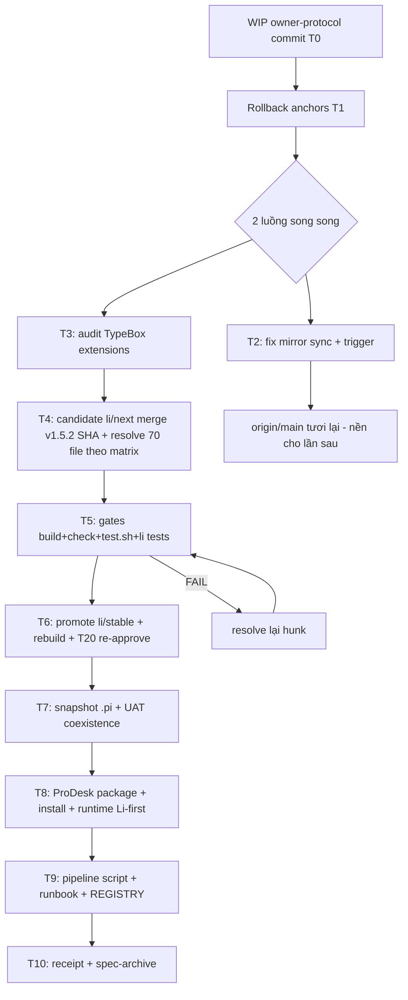

# Spec: Upstream Li lên v1.5.2 + hệ thống hóa pipeline upstream cho fork fleet

## Context Snapshot
- Project / module: Li — fork build runtime từ `pi-mono` (upstream `earendil-works/pi`); worktree chính `D:\pcloud\workspace\code\pi-mono-li`, branch `li/stable`. Runbook: `docs/li-maintenance.md`. Registry: `D:\pcloud\workspace\knowledge\upstream-forks\REGISTRY.md` (entry pi-mono, trạng thái `paused-upstream`).
- Supersedes: none (spec mới; tham chiếu SPEC-2026-10-19-li-private-runtime cho hợp đồng routing runtime, SPEC-2026-10-22-li-prodesk-linux-install cho lane ProDesk).
- Stack / runtime: Node v22.22.0, TypeScript monorepo (pnpm-style npm workspaces), build qua `scripts/build-li.mjs --offline`, artifact `packages/coding-agent/dist/bundle/cli.js`, receipt `li-build-receipt.json`.
- Current behavior (đo live 2026-11-18):
  - Li chạy base **v1.3.0** (receipt: source `46ddc71954`, build 14-11, artifact sha256 `f8d22460…`, clean).
  - Upstream thật `earendil-works/pi` main = `05fd3fbda0bb` (tag v1.5.2, 10-11). Li behind **1064 commits**; merge-base `1402973a9dbe` (thời v1.3.0).
  - Fork mirror `origin/main` = `1757f0cc6cff` — stale hơn upstream 244 commit vì sync workflow FAIL từ 11-14 (GITHUB_TOKEN thiếu `workflows` permission khi merge commit chạm workflow files — REGISTRY Known issues #1).
  - WIP `session-owner-protocol` đã commit `ee569f77d2` (9 files, 1153 insertions), docs spec commit `32f4068098`; T9 pipeline script commit `89f82904e4`. Candidate current head sau merge + T5 fix: `ecac186570`.
  - Custom delta Li: **147 files**; trong đó **70 files** nằm trong vùng upstream v1.3.0→v1.5.2 cũng sửa (conflict surface). Cơ chế guard Li đo được bị upstream đụng đúng vùng: `rejectLiSelfUpdate()` (package-manager-cli.ts, upstream +149 dòng flow self-update mới), `applyLiRuntimeEnv()` (main.ts, +120/−37), strip `LI_*` env (shell.ts, +59/−13), entry-type allowlist (session-manager.ts — upstream đổi write path #11253 + fix #11460, CHƯA thấy thêm entry type mới), TUI components (blank style/selection/locale VI đè lên fix upstream: Kitty image, highlight reuse #10971, CJK markdown, PageUp/PageDown #7629).
  - Upstream v1.5.0 có **breaking change**: tool argument validation chuyển sang `@earendil-works/pi-schema` — TypeBox ngoài JSON Schema (`Type.Refine()`, `Type.BigInt()`, `Type.Undefined()`, codecs) không còn áp dụng cho tool args. Extension closure nằm NGOÀI repo Li: `D:\pcloud\workspace\code\python\app_presets\pi\extensions\` (subagent-tab, handoff, peer-sessions, pi-osc-patch-guard, shared/resolve-runtime-cli.ts…).
  - T20 promotion: `C:\Users\quocn\.pi\agent\session-open-leases\registry.json` approved_builds pin artifact sha256 cũ; sau rebuild bắt buộc re-approve nếu không mọi `/trim` refuse `promotion_required` (vụ 12/11).
- Desired behavior: Li chạy v1.5.2 giữ 100% custom riêng; ProDesk lên cùng release và runtime mặc định cho tab workflow là Li; pipeline upstream thành flow chuẩn, lần sau ít thủ công hơn; mọi bước có rollback anchor.

## Objective
- Nâng Li từ v1.3.0 lên **v1.5.2 (pin full SHA của tag)** qua candidate `li/next`, giữ nguyên toàn bộ tính năng/config/build riêng, có rollback anchor ở từng tầng (branch ref, receipt, T20 registry, ProDesk pointer).
- Sửa mirror sync để `origin/main` tươi lại (lần merge sau không nợ data).
- Hệ thống hóa quy trình upstream thành pipeline chuẩn hóa (script + runbook + registry) tái dùng cho các fork khác trong fleet.
- Success trông thế nào: `li --version` = `1.5.2 (source <new-sha>)`; gates xanh; T20 approved; UAT coexistence pass; ProDesk tab spawn Li; lần upstream sau chỉ cần đổi target SHA và chạy lại pipeline.

## Scope
- In:
  - Commit WIP `session-owner-protocol` thành commit riêng trên `li/stable` (verify test trước).
  - Rollback anchors: backup branch ref, backup T20 registry + canary receipt, ghi rollback SHA vào receipt.
  - Merge candidate: worktree `pi-mono-next` từ `li/stable`, merge target SHA v1.5.2, resolve 70 file conflict theo matrix ở Approach.
  - Audit TypeBox/pi-schema impact trên extension closure (scout, output bảng file:line + verdict).
  - Gates đầy đủ theo runbook + focused Li tests + smoke resume-tool-loadout.
  - Promote `li/stable` + rebuild + T20 re-approve + snapshot `~/.pi` trước boot thật.
  - ProDesk: package release Li mới + install user-local + đổi runtime mặc định spawn cho ProDesk tab/service sang Li, giữ rollback pointer (bin/li cũ).
  - Fix mirror sync template (thêm `workflows: write` permission, chốt strategy) + trigger sync lại pi-mono.
  - Pipeline systemize: đóng flow candidate→gates→promote→receipt thành script + cập nhật runbook/REGISTRY; đề xuất cập nhật skill `upstream-maintenance` references cho fleet (sửa skill phải owner duyệt).
- Out:
  - Không đụng tính năng WIP khác; không refactor ngoài vùng conflict.
  - Không đổi session format / entry types (nếu upstream thêm entry type mới → chỉ thêm vào allowlist sau khi hiểu ngữ nghĩa + có projection test; nếu thấy trong diff, escalate về owner trước khi merge).
  - Không nâng các fork khác (kaneo, Recordly, Ditto…) — pipeline document là để họ dùng sau.
  - Không bật auto-merge/auto-upstream cho `li/stable` — vẫn merge thủ công có review.
  - Không cài lại Pi ProDesk hay đụng `pi_core_manager.py`.

## Thuật ngữ
- **Upstream thật** = repo `earendil-works/pi` (nguồn gốc). **Mirror** = nhánh `main` của fork `nguyendinhquocx/pi-mono` tự sync hằng ngày. Số behind 2 bên khác nhau — luôn ghi rõ so với bên nào.
- **Candidate** = worktree nhánh `li/next` nơi merge + gates chạy; chưa bao giờ là runtime. **Promote** = fast-forward `li/stable` tới candidate sau khi mọi gate PASS, rồi rebuild ở worktree chính.
- **Guard Li** = code giữ hành vi riêng Li: `rejectLiSelfUpdate()`, `applyLiRuntimeEnv()`, strip `LI_*` khỏi env lệnh ngoài, `KNOWN_SESSION_ENTRY_TYPES` allowlist, Li TUI style (blank/borderless/selection →), locale VI.
- **Conflict surface** = file cả Li và upstream cùng sửa trong khoảng merge-base→target (đo live, không dùng số cũ).
- **T20 promotion gate** = re-approve build mới trong `registry.json` (`approved_builds` + `t20_receipt_sha256`) sau rebuild; thiếu thì `/trim` refuse.
- **pi-schema** = package validation tool args mới từ v1.5.0; breaking với TypeBox ngoài JSON Schema.
- **Execution Environment / runtime mặc định ProDesk** = CLI mà service/tab ProDesk spawn (`pi` hiện tại → đổi sang `li`).
- **Matrix conflict** = bảng quyết định resolve từng nhóm file (guard Li thắng / upstream fix thắng / hòa cả hai) — xem Approach.

## Assumptions
- Owner xác nhận writer session đã xong `session-owner-protocol` và WIP đó là feature hoàn chỉnh, test được (nếu test fail khi commit → dừng, escalate).
- Target là **v1.5.2 hiện tại** (tag `v1.5.2` → resolve full SHA lúc merge), không đợi release mới.
- Máy laptop đủ deps như build 14-11 (Node 22, npm ci offline hoạt động).
- ProDesk sẵn SSH lane + snapshot profile flow như runbook (`~/.local/state/prodesk-li/profile-snapshots/`).
- Fetch trực tiếp từ upstream thật là nguồn chuẩn cho merge (không đợi mirror sync — mirror chỉ là tiện ích docs/CI).
- Owner dùng Li 100% trên laptop — sau promote, mọi session mới đều Li; Pi global vẫn tồn tại làm coexistence baseline.

## Open Questions
- Pipeline script đặt ở đâu: trong repo Li (`scripts/upstream-merge.mjs`) hay toolkit Python (`--li-upstream-*`)? Spec chọn repo Li (để gates build/test dùng chung toolchain), chỉ ghi receipt/call API qua toolkit sẵn có. Owner có thể đổi khi review.
- Skill `upstream-maintenance` references có cần section "fleet pipeline" chung không — đề xuất có, nhưng sửa skill chờ owner duyệt riêng (self-improvement gate).

## Approach
- Chọn: **merge cả block v1.5.2 một lần** qua candidate worktree, không cherry-pick từng fix.
- Lý do: behind 1064 commit gồm hàng trăm fix nhỏ chồng chéo (provider compat, MCP, TUI); review rời từng commit đắt hơn merge block có gates chặn regression. Conflict surface đã đo (70 file) và pattern resolve đã có trong runbook — đây là merge có bản đồ, không phải merge mù.
- Chiến lược fetch: fetch thẳng `https://github.com/earendil-works/pi.git` (đã có trong object store từ recon) — không phụ thuộc mirror.
- **Matrix resolve conflict (quyết định sẵn, không tranh từng hunk):**
  1. Nhóm guard Li (`main.ts` bootstrap, `package-manager-cli.ts` update flow, `shell.ts` env strip, `session-manager.ts` allowlist, `config.ts`, `extensions/loader.ts` + `virtual-modules.ts` bundled module map): **giữ guard Li + lấy fix/feature upstream quanh guard**. Ví dụ: thêm flow `PI_SELF_UPDATE_COMMAND` mới của upstream BÊN DƯỚI `rejectLiSelfUpdate()`. Phân nhánh `migrations.ts`: nếu upstream đã tự fix Windows basename cùng bug → **DROP Li patch**, không giữ double-fix.
  2. Nhóm TUI components (markdown, tool-execution, user-message, session-selector, tree-selector, editor…): **giữ Li style + lấy fix logic upstream**; khi fix logic nằm cùng hunk với style → tách hunk, verify bằng Li tests + test.sh nhóm TUI.
  3. Nhóm infra/docs/workflows (`.github/`, README, package-lock): **theo upstream**, trừ workflow `sync-upstream.yml` — giữ nguyên bản hiện có của Li trong candidate. T2 là lane CI độc lập (repo Python toolkit), không phải điều kiện biên của T4.
  4. Nhóm tests: **theo upstream + giữ Li assertions platform-aware**; file `test/li-*.test.ts` không bao giờ bị upstream đụng (an toàn tuyệt đối).
  5. `package.json` / lockfile: hòa — giữ `piConfig`/`bin` Li, nhận deps mới upstream; root `workspaces` giữ glob `packages/*` + nhận entries mới upstream thêm (đối chiếu diff — vd upstream thêm `packages/chord/test/examples/...`); `install-lock/package-lock.json` nhận entry pi-schema.
  6. Nhóm provider/catalog/model list (`packages/ai/catalog/`, `generate-models.ts`, `models.json` schema, catalog output): **giữ hide/add riêng của Li** (commit `4ac7c9f58` — Terra qua openai-codex, hide entry api.openai theo owner request), **nhận structure mới models.dev v2**; verify bằng diff catalog candidate vs backup — Li entries không mất.
  7. Nhóm new packages & workspace wiring (vd `packages/schema` — package mới hoàn toàn của upstream v1.5.x, ~160 files, dep của `packages/agent`): **upstream wins toàn bộ nội dung**; wiring nhờ root workspaces glob `packages/*` (cả 2 bên dùng glob, không cần thêm entry tay) nhưng PHẢI verify sau merge: `npm ci` resolve `@earendil-works/pi-schema`, `install-lock/package-lock.json` có entry mới (upstream commit `d71c66e05b` pack pi-schema cho install lock), `build-li.mjs --offline` bundle có chunk pi-schema, `li --version` chạy.
  8. Catch-all: conflict file không khớp nhóm 1-7 → **KHÔNG resolve đoán**, list vào candidate receipt + escalate owner quyết định, quay lại merge sau.

- **Ràng buộc vá extension (pi-schema break):** audit (T3) chạy TRƯỚC merge; nếu có BREAK → plan vá phải có trước khi merge, nhưng **CẤM deploy extension patch chỉ-tương-thích-runtime-mới lên `C:\Users\quocn\.pi\agent\extensions` trước promote** (runtime cũ Pi/Li đang chạy load chung closure đó, sẽ gãy session đang mở). Chỉ 2 đường hợp lệ: (a) patch **compat 2 chiều** (chạy được trên runtime v1.3.0-era lẫn v1.5.2, test được cả hai) apply sau T6; hoặc (b) BREAK được vá SAU promote, TRƯỚC T7, với rollback `*.bak` từng file extension.
- Thứ tự: T0 (đóng WIP) → T1 (anchors) → T2 (mirror fix, chạy nền) ∥ T3 (audit TypeBox scout) → T4 (candidate merge) → T5 (gates) → T6 (promote + T20) → T7 (UAT) → T8 (ProDesk) → T9 (pipeline) → T10 (receipt + archive).

## Diagram

## Bỏ qua
- Cherry-pick từng fix theo nhu cầu (chậm, dễ sót phụ thuộc chéo giữa fix).
- Đợi mirror sync xanh rồi mới merge (merge dùng fetch upstream thật; mirror fix T2 chạy song song, chỉ phục vụ data tương lai).
- Đưa closed models mới / đổi model catalog riêng của owner (catalog upstream models.dev v2 sẽ theo merge, owner settings override giữ nguyên).
- Tự sửa skill `upstream-maintenance` ngay trong đợt này (chỉ đề xuất nội dung, owner duyệt rồi mới sửa).

## Risks
- **pi-schema breaking** với extension closure ngoài repo — closure là **shared runtime** Pi + Li đang cùng load từ `~/.pi/agent/extensions`: audit T3 TRƯỚC merge (đủ 4 mục: regex mở rộng, MCP validate path, compile() bridge runtime test, Static re-export), plan vá trước merge, deploy CHỈ sau promote (compat 2 chiều hoặc staged sau T6 trước T7, kèm `*.bak`) — chi tiết ràng buộc ở Approach. False negative audit = rollback đắt sau merge, nên T3 phải có evidence từng mục chứ không phải verdict SAFE trống.
- **New package integration (`packages/schema`)**: package mới hoàn toàn ~160 files — merge tự add, rủi ro nằm ở wiring (workspace resolve, install-lock, bundle path) — chặn bằng gate T5 nhóm 7 matrix; nếu build-li.mjs không bundle pi-schema → Li chạy v1.5.2 thiếu validation core, gãy tool args im lặng.
- **TUI conflict phức tạp** (fix render perf #10971 đè style Li) — tách hunk + chạy nhóm TUI tests; rủi ro còn lại bắt bằng UAT nhìn màn hình.
- **WIP dirty** — quy tắc cấm merge trên dirty tree; T0 đóng trước, không ngoại lệ.
- **ProDesk runtime đổi = production mutation** — snapshot profile + installer verify + rollback pointer bắt buộc; deploy chỉ sau UAT laptop PASS.
- **Session format drift**: nếu phát hiện upstream thêm entry type trong 1064 commit → escalate owner, thêm allowlist có projection test trước promote.
- **T20 quên re-approve** → `/trim` refuse 2 ngày như vụ 12/11 — T6 có checklist cứng.
- **Windows test residual**: `test.sh` không green 100% trên Windows (nhóm đã biết trong runbook) — gate là `npm run check` + focused suites PASS + residual đúng nhóm đã liệt kê; khác nhóm đã biết = FAIL.

## Task List

### Task 0: Đóng WIP session-owner-protocol
- Acceptance:
  - 9 file WIP thành 1 commit riêng trên `li/stable`, message mô tả feature đúng.
  - `npm run check` PASS; focused test `session-owner-handoff.integration.test.ts` PASS.
  - Worktree sau commit chỉ còn untracked `docs/specs/**` (working spec + artifacts); mọi file code không còn modified/untracked. Commit spec thành docs commit thứ hai ngay trong T0 để tree sạch tuyệt đối trước merge.
- Reproduce: `cd /d D:\pcloud\workspace\code\pi-mono-li && git status --porcelain` (trống — sau khi cả 2 commit feature + docs landed) && `node "D:/pcloud/workspace/code/pi-mono-li/node_modules/vitest/dist/cli.js" --run --testTimeout 30000 packages/coding-agent/test/session-owner-handoff.integration.test.ts`
- Lưu ý: test này là Vitest suite spawn 2 child process thật — trên Windows tổng suite ~23s, BẮT BUỘC `--testTimeout 30000` (default 5s sẽ fail 3/5); chạy bằng node:test/tsx sẽ crash (`Vitest failed to find the current suite`).
- Verify: git log commit mới + test output.
- Files: `packages/coding-agent/src/core/session-owner-protocol.ts`, `src/core/agent-session.ts`, `src/core/session-open-lease.ts`, `src/modes/interactive/interactive-mode.ts`, `src/modes/rpc/rpc-mode.ts`, `src/modes/rpc/rpc-types.ts`, `src/rpc-entry.ts`, `test/fixtures/owner-protocol-child.ts`, `test/session-owner-handoff.integration.test.ts`.

### Task 1: Rollback anchors
- Acceptance:
  - Backup branch `li/stable-backup-20261118` trỏ đúng HEAD trước merge; backup `registry.json` + `t20-canary-receipt.json` thành `*.bak-20261118`.
  - Ghi rollback SHA (HEAD sau T0) vào draft receipt.
- Reproduce: `git rev-parse li/stable-backup-20261118` khớp `git rev-parse li/stable~0` lúc đo.
- Files: ngoài repo (refs + `~/.pi/agent/session-open-leases/`).

### Task 2: Fix mirror sync (chạy nền, song song T3)
- Acceptance:
  - **Implementation đã đổi theo evidence thật**: KHÔNG thêm `workflows: write` (GitHub reject YAML bằng HTTP 422 `Unexpected value workflows` — GITHUB_TOKEN không cấp scope này). Giữ strategy preserve: merge upstream, rồi restore workflow files fork trước merge; template strategy merge-thẳng-main. Thêm flag `--repo <name>` để update đúng một fork, không deploy fleet ngoài scope.
  - Chạy `--github-fork-sync-install --update --repo pi-mono`, trigger Actions đúng pi-mono; run `44234025683` PASS trong 24s, `origin/main` behind 263→0. Không đụng iptv/fleet.
  - T2 không ảnh hưởng T4 merge source (fetch thẳng upstream thật); chỉ sửa mirror cho lần sau.
- Reproduce: `py -3.13 D:\pcloud\workspace\code\python\quoc.py --github-fork-sync-status --user nguyendinhquocx --json` → pi-mono run `44234025683` success; behind 0.
- Files: `D:\pcloud\workspace\code\python\toolkit_modules\tools\github_fork_sync.py` (pattern: hàm render template current trong file).

### Task 3: Audit TypeBox/pi-schema trên extension closure (scout, read-only)
- Acceptance:
  - Bảng kết quả file:line / schema / construct / verdict SAFE|BREAK / đề xuất. Kết quả T3: 0 BREAK, 0 extension patch cần deploy.
- Reproduce: `rg -n "Type\.(Refine|BigInt|Undefined|Object\(|Array\(|String\(|Number\(" D:\pcloud\workspace\code\python\app_presets\pi\extensions` + đọc context.
- Thêm 4 mục audit — kết quả read-only T3:
  - Extension tools chỉ dùng `Type.Any/Optional/Array` + JSON Schema cơ bản; không có `Refine/BigInt/Undefined/Transform/codec/Format.Set` → SAFE.
  - Render mutation #9549: 6 custom TUI components quét, 0 mutate `render()` output in-place → SAFE.
  - MCP tools qua chung `normalizeMcpInputSchema` (`packages/coding-agent/src/extensions/mcp/tools.ts:269`); `mcp.json` chỉ có browse stdio config, không có schema key rủi ro → SAFE.
  - TypeBox→pi-schema bridge: loader virtual modules map `typebox`, `typebox/compile`, `typebox/value`; `Static` import type bị erase, pi-ai-schemas expose pi-schema với TypeBox-compatible JSON → SAFE theo source. **Pending T5:** runtime unit test `compile()` nhận schema TypeBox, chưa chạy.
- Regex mở rộng: `Type.(Refine|BigInt|Undefined|Transform|Any)` + `codec` + `Format.Set` — `Type.Any()` (dùng ở pi-firecrawl `tools.ts:54,102,185`) SAFE với pi-schema nhưng vẫn ghi vào bảng để có bằng chứng đã xét.
- Render mutation audit: upstream v1.5.0 breaking change #9549 — `render()` trả `readonly string[]`, Container cache cùng array khi children không đổi. Scan mọi custom TUI component trong extension closure (subagent-tab, pi-ask, peer-sessions, handoff, terminal-relay): chỗ nào mutate render output in-place (`push`/`splice`/`pop` trên kết quả `render()` hoặc `super.render()`) → BREAK, phải copy trước khi biến đổi.
- Files: read-only, không sửa.

### Task 4: Candidate merge v1.5.2
- Acceptance:
  - Candidate branch `li/next`; target v1.5.2 full SHA `05fd3fbda0bbb9a1c7a76e4bf92ab58ed77c8d94`. Surface sau T0: 72 overlap files; merge tạo 30 conflict thực, auto-merge phần còn lại. Merge commit `356a874b37`; T9 merge-in `4158515a98`; conflict resolve theo matrix, resolution nằm trong commit body.
  - Candidate hiện tại `ecac186570`; CHƯA promote.
  - `git grep rejectLiSelfUpdate`, `git grep applyLiRuntimeEnv`, `git grep LI_UI_LANGUAGE` đều còn present trong candidate.
  - Kiểm entry types: diff session-manager candidate vs backup không mất allowlist key nào.
- Reproduce: `git -C D:\pcloud\workspace\code\pi-mono-next log --oneline -2` (merge commit trên cùng) && `git grep -c "LI_" -- packages/coding-agent/src/main.ts`.
- Files: toàn bộ 70 file conflict surface (đo lại live trước merge — số cũ chỉ là định hướng).

### Task 5: Gates trên candidate
- Acceptance:
  - `npm ci --ignore-scripts` PASS; `packages/schema` + `@earendil-works/pi-schema` resolve. Trước build chạy `npm run hydrate:model-data` (catalog JSON generated mới); sau đó regen install-lock rồi build.
  - **Trước `npm run check`**: sau khi resolve `package.json`/lockfile (dùng `npm install --package-lock-only --ignore-scripts` nếu cần), chạy `node scripts/generate-coding-agent-install-lock.mjs` regen install-lock — không regen thì `check:install-lock:coding-agent` FAIL chắc chắn vì upstream đổi deps (pi-schema mới, undici bump).
  - `node scripts/generate-coding-agent-install-lock.mjs` → `node scripts/build-li.mjs --offline` → `npm run check` PASS. Terra Li rule port sang `packages/ai/catalog/providers/openai.ts` (hide direct OpenAI) + `openai-codex.ts` (1M context); `hydrate:model-data` verify OpenAI data không có Terra, Azure Foundry/Codex vẫn có.
  - `li --version` từ candidate receipt khớp v1.5.2; bundle 84 files / 9.5 MiB có pi-schema. Li suites 75/75 PASS; `default-tools-setting` 41/41 PASS (Li migration + upstream branch/compaction/allowlist tests); owner-protocol 5/5 PASS.
  - Full `packages/coding-agent/test` lần cuối (HEAD `268317eb5d`): candidate 44 fail / 3238 pass / 94 skip trên 22 files; baseline v1.3.0 46 fail / 2799 pass / 66 skip. Phân loại: 12 failures T20-gated đúng 2 file (`agent-session-in-place-refresh`: 9; RPC #10470: 3) vì candidate SHA chưa T20-approved; 3 failures là timeout 30s dưới full-suite load (`agent-session-runtime-events`, `suite/agent-session-runtime`, `2860-replaced-session-context` — isolated 22/22 PASS, cùng code 2 full-run cho kết quả khác nhau → flaky theo load, không phải regression); 29 shared failures không vượt baseline (29↔29), 17 baseline-only failures nay pass. **Non-T20, non-flaky delta = 0 → T5 PASS có điều kiện**; re-run 12 T20-gated sau T6, trước UAT/ProDesk; còn fail thì block. Independent review xác nhận #10470 fail ở promptOnce trước switch/fork/clone, chưa phải bằng chứng lỗi replacement.
  - `bash ./test.sh` trên Git Bash fail duy nhất `preview-packages.test.mjs`: GNU tar parse Windows drive path (`Cannot connect to C: resolve failed`). Chạy riêng với Windows System32 `tar.exe` + `npm_execpath` explicit thì 10/10 pass; `test.sh` sanitizer không truyền npm_execpath/script environment đúng cho test này. Đây là runner/platform issue, không fail logic/package artifact; Linux CI gate cần xanh trước promote.
  - `resume-tool-loadout-smoke.ps1` không build được candidate worktree external: TypeScript type brand conflict giữa dist `packages/ai` của temp copy và candidate worktree do npm workspace resolve hai real path. Chưa bypass; cần chạy sau promote hoặc sửa harness có gate riêng.
- Reproduce: `cd D:\pcloud\workspace\code\pi-mono-next && npm ci --ignore-scripts && npm run hydrate:model-data && node scripts/generate-coding-agent-install-lock.mjs && node scripts/build-li.mjs --offline && npm run check` (Git Bash). Full suite: `node node_modules/vitest/dist/cli.js --run --testTimeout 60000 packages/coding-agent/test/`.
- Files: build outputs candidate.

### Task 6: Promote + rebuild + T20
- Acceptance (thứ tự cứng, không đảo):
  1. `li/stable` fast-forward tới candidate (chỉ khi T5 PASS).
  2. Snapshot `~/.pi` TRƯỚC (robocopy ACL user-only theo runbook, đặt ID rõ vd `pi-snapshot-2026-11-18-v152`) + **verify độc lập snapshot counts + SHA PASS** trước bước sau.
  3. Gán `$env:LI_PROFILE_SNAPSHOT_ID = "<snapshot-id>"` rồi `node scripts/build-li.mjs --offline` ở worktree chính — build-li đọc env LÚC BUILD và ghi vào receipt; build trước snapshot → receipt `profileSnapshotId: null`, phải build lại.
  4. T20 re-approve với công thức rõ: đọc `artifactHash` từ `li-build-receipt.json` → cập nhật `t20-canary-receipt.json` (`artifact_sha256` mới) → tính `t20_receipt_sha256 = SHA256(toàn bộ nội dung t20-canary-receipt.json)` → cập nhật `registry.json`: `approved_builds[].artifact_sha256` mới + `t20_receipt_sha256` mới. Backup cả 2 file `*.bak` trước khi sửa.
  5. Verify khớp chéo: `li --version` khớp receipt; `approved_builds[].artifact_sha256` == receipt `artifactHash` == canary `artifact_sha256`; `t20_receipt_sha256` == SHA256(canary file). Lệch bất kỳ cặp nào → `/trim` sẽ refuse `promotion_required`.
  6. Diff catalog candidate vs backup: Li entries (Terra openai-codex, các hide riêng) không mất sau merge (matrix nhóm 6).
- Reproduce: `li --version` && `py -3.13 -c "import json;print(json.load(open(r'C:/Users/quocn/.pi/agent/session-open-leases/registry.json'))['approved_builds'])"` chứa artifact hash mới.
- Files: repo dist + `~/.pi/agent/session-open-leases/registry.json`.
- **Kết quả T6 (2026-11-18): PASS.** (1) T5 chốt PASS có điều kiện → commit test fixes `5084b1dea6` (fixture `baseVersion: VERSION` + waitFor 15s cho replacement flow) rồi FF hai chiều `li/stable` ⇄ `li/next` cùng đỉnh `5084b1dea6`. (2) Snapshot `~/.pi` = `pi-snapshot-2026-11-18-v152`: robocopy `/MT:16` exit 3 (lần đầu exit 9 do transient dir lock — rerun sạch); ACL user-only `icacls /inheritance:r` PASS; `auth.json`+`settings.json` SHA256 MATCH; đích dư ~171k stale files (subagent-tab worktree + extensions cũ, robocopy không purge) + thiếu vài chục file session live sinh sau snapshot — chấp nhận cho recovery anchor. (3) Build receipt clean @`5084b1dea6`, `profileSnapshotId` đúng, artifact `693b38dc…7622`. (4) T20 re-approve: backup `*.bak-20261118-v152`, canary `artifact_sha256` + `supersedes` build cũ `f8d22460…6836`, `t20_receipt_sha256` = SHA256(canary) — khớp chéo 3/3 ALL-MATCH. (5) `li --version` = 1.5.2 (source `5084b1dea6`); artifact hash ổn định qua rebuild (test-only commits không đổi bundle). (6) Terra markers present ở catalog pipeline mới (`families/openai.ts`, `providers/openai.ts` hide, `openai-codex.ts` 1M, `azure.ts` re-derive); backup branch giữ layout cũ `generate-models.ts` — port đúng matrix nhóm 6. T20-gated 12 tests giờ PASS (isolated); full-suite còn 7 timeout/EBUSY flakes under load trên 5 files (10470 hook timeout 10s + cleanup EBUSY, in-place-refresh 30s per-test, runtime-events/runtime suites) — isolated 42/42 PASS, không correlate code, phân loại flaky-under-load Windows.

### Task 7: UAT coexistence (gate user)
- Acceptance:
  - Từ cùng CWD: `li` và `pi` chạy được, cùng profile/session list, identity/version riêng; không mở cùng session file đồng thời.
  - Từ Li: `subagent_tab` spawn → child chạy Li CLI (verify qua `resolve-runtime-cli` log/pid cmdline); `li update` bị từ chối trước mọi side effect.
  - Session mới gõ tiếng Việt UI vẫn đúng; `/trim` hoạt động (T20 approved); compaction chạy trên session dài.
- Reproduce sau promote (T20 approved): `powershell -NoProfile -File tests/super-parent/resume-tool-loadout-smoke.ps1 -LiRepo ..\pi-mono-li -ExtensionSource app_presets\pi\extensions` (từ Python repo). Candidate external worktree hiện fail TypeScript branded-type resolution do hai real workspace paths — không bypass; nếu vẫn fail sau promote, mở task sửa harness.
- Files: không sửa (verify-only).
- **Kết quả T7 (2026-11-18): PASS — user UAT đủ 6 mục**: (1) boot `li` từ CWD project, UI VI render đúng; (2) session list chung với `pi` (cùng profile); (3) `/trim` chạy trên runtime thật (T20 approved); (4) compaction trên session dài OK; (5) subagent_tab spawn từ Li → child chạy Li CLI; (6) không mở cùng session file 2 runtime đồng thời. Auto-verify kèm: `li update` refuse đúng contract không side effect; `li --help` identity Li; smoke harness sau promote vẫn fail branded-type 2 workspace paths — đúng bệnh đã ghi, mở task riêng post-promote (không block).

### Task 8: ProDesk deploy + Li-first runtime
- Acceptance (luồng 2 chặng, cấm gộp):
  - **Chặng 1 — ProDesk snapshot trước**: SSH ProDesk chạy script snapshot profile (runbook) → nhận `prodesk_snapshot_id` + receipt counts/SHA PASS.
  - **Chặng 2 — Laptop rebuild + package**: `$env:LI_PROFILE_SNAPSHOT_ID = "<prodesk_snapshot_id>"` → `node scripts/build-li.mjs --offline` (bắt buộc rebuild — packager đọc `profileSnapshotId` từ receipt TRÊN ĐĨA, không phải env của shell lúc pack; dùng bundle build từ T6 với snapshot ID laptop → installer ProDesk từ chối vì ID không khớp) → `node scripts/package-prodesk-li.mjs --output packages/coding-agent/dist/prodesk-li-release` → transfer qua fixed lane.
  - ProDesk: `node --test` installer tests PASS trong temp HOME; snapshot profile PASS (receipt counts/SHA); `install-prodesk-li.sh --check-readiness` rồi `--yes`; `~/.local/prodesk-li/bin/li --version` khớp.
  - Đổi runtime mặc định spawn của ProDesk tab/service sang Li (config/launcher ở `app_presets/home_server/pi-agent/` + service config ProDesk): **scope mặc định chỉ áp cho tab spawn MỚI**; nếu phải restart service đang chạy (production mutation) thì tách checkpoint riêng + cửa sổ restart rõ ràng + báo owner trước. **Drain strategy bắt buộc trước khi switch**: list + confirm Pi sessions đang chạy trên ProDesk (`ps aux | grep prodesk-pi`), đợi hoặc graceful terminate TRƯỚC khi đổi default; sau switch verify không còn process mới spawn từ `~/.local/prodesk-pi/current` (process Pi cũ đang sống được phép tồn tại đến khi tự kết thúc — cấm kill mù). Kiểm 1 tab mới spawn bằng `~/.local/prodesk-li/current` bundle. Rollback pointer giữ (`~/.local/prodesk-pi` nguyên vẹn, install script có `--rollback`).
- Reproduce: `ssh prodesk-home '~/.local/prodesk-li/bin/li --version'` + cmdline của tab mới (`ps aux | grep prodesk-li` hoặc tab status).
- Files: `D:\pcloud\workspace\code\python\app_presets\home_server\pi-agent\` (config spawn runtime — pattern: `install-prodesk-pi.sh` biến CLI path), ProDesk user-scope config.

### Task 9: Pipeline systemize
- Acceptance:
  - Script `scripts/upstream-merge.mjs` (hoặc shell) đóng flow: fetch upstream thật → đo behind/conflict surface → tạo candidate → checklist gates → promote + T20 checklist → receipt template. Có `--dry-run` in plan không mutate.
  - Auto-group conflict surface: script output `conflict-matrix.json` — danh sách file conflict tự phân nhóm theo matrix (guard/catalog/new-package/infra/TUI/tests/catch-all) bằng path matching, reviewer chỉ confirm thay vì phân loại tay; kèm **guard overlap verdict** (guard file nào bị upstream đụng thêm so với lần trước — so merge-base cũ/mới).
  - Parameterize cho fleet reuse: `--guard-files <glob>` / `--custom-files <glob>` per-fork (mặc định profile Li), để kaneo/Ditto dùng lại flow không phải fork script.
  - `docs/li-maintenance.md` cập nhật: bước 6 smoke TUI profile cô lập (PI_CODING_AGENT_DIR) + bước 7 T20 checklist + vị trí receipt (Known issues #7a-c).
  - `REGISTRY.md`: entry pi-mono `upgrading`; Known issue #1 ghi đúng preserve-workflow fix (không thêm `workflows: write`); #7 cập nhật việc đã xong/đang chờ gate — chưa close sớm. T9 commit `89f82904e4`, script dry-run PASS; `conflict-matrix.json` nhóm 8 type + guard-overlap + catch-all, `--guard-files`/`--custom-files` per-fork. Mirror update an toàn thêm `--repo <name>`; fleet khác chưa deploy.
  - `DRAFT-skill-patch-upstream-maintenance.md` đã tạo; skill thật CHƯA sửa (đợi owner duyệt).
  - Đề xuất patch skill `upstream-maintenance` (section pipeline fleet) ghi vào draft — chờ owner duyệt rồi mới sửa skill.
- Reproduce: `node scripts/upstream-merge.mjs --dry-run` in đúng plan từ state hiện tại.
- Files: `scripts/upstream-merge.mjs`, `docs/li-maintenance.md`, `D:\pcloud\workspace\knowledge\upstream-forks\REGISTRY.md`.

### Task 10: Receipt + archive
- Acceptance:
  - Upstream maintenance receipt theo template skill (`<repo>/docs/maintenance-receipts/2026-11-18-<target-short-sha>.md`): default branch, base SHA, target SHA, changed paths, conflict/resolution + lý do, verify results, backup IDs, rollback SHA, artifact hash.
  - `spec-archive` chuyển working spec vào `docs/specs/SPEC-2026-11-18-li-upstream-v152-pipeline/` + INDEX regenerate; chỉ close khi `spec-check`/archive verify pass.
- Reproduce: `ls docs/specs/SPEC-2026-11-18-li-upstream-v152-pipeline/` có SPEC.md + RECEIPT.
- Files: docs/specs/**.

## Checkpoints
- Sau T0: worktree clean + test focused PASS — mới được phép vào T4.
- Sau T3: audit bảng có BREAK chưa có plan vá → dừng chốt plan (compat 2 chiều hoặc staged apply sau T6 — xem ràng buộc vá extension trong Approach); CẤM deploy patch chỉ-tương-thích-mới lên profile thật trước promote.
- Sau T4: diff-stat candidate (`git diff li/stable..li/next --stat`) review against conflict matrix — file ngoài surface bị đổi = sai.
- Sau T5 (chốt PASS có điều kiện): build chain + `npm run check` + Li suites PASS; full suite delta thực = 12 T20-gated (2 files) + 3 timeout flaky theo load (isolated PASS); non-T20 delta = 0. Candidate commits `269a4c961d` (MCP late-restore + test identity fixes) + `268317eb5d` (bash-close cleanup retry). Re-run 12 T20-gated sau T6; Linux CI preview-package verify bắt buộc trước ProDesk.
- Sau T7: UAT user PASS mới ProDesk deploy (production gate).
- Trước DONE: reconcile todo + receipt + archive.

## External Review Brief
### Reviewer cần phán
- Scope có đúng job chính không — có overengineer/thiếu bước nào (đặc biệt ProDesk runtime Li-first: cách đổi spawn có an toàn với Pi ProDesk services đang chạy)?
- Matrix resolve conflict (5 nhóm) có hợp lý, có nhóm nào thiếu (vd MCP code, provider compat files nằm nhóm nào)?
- Thứ tự T0→T10 + dependency có sai (T2 chạy nền có rủi ro gì)?
- Verify/acceptance từng task có bắt được lỗi thật (đặc biệt T5 gates trên Windows, T8 installer verify)?
- Risk pi-schema audit T3 có đủ (có nên audit cả MCP servers trong mcp.json không)?
- Pipeline T9 có giải quyết đúng "lần sau bớt thủ công" hay chỉ script hóa quy trình cũ?

### Reviewer nên đọc trước
- `docs/li-maintenance.md` (runbook gates + ProDesk + rollback)
- `D:\pcloud\workspace\knowledge\upstream-forks\REGISTRY.md` (entry pi-mono + Known issues #1/#6/#7)
- Changelog upstream: `git show 05fd3fbda0bb:packages/coding-agent/CHANGELOG.md | head -400` (trong worktree Li đã fetch)
- `scripts/build-li.mjs` + `scripts/package-prodesk-li.mjs` (build/ship lane hiện có)
- `app_presets\pi\extensions\shared\resolve-runtime-cli.ts` (hợp đồng routing Li/Pi)

### Reviewer không cần phán
- Model policy / model router owner.
- Nội dung feature `session-owner-protocol` (đã xong ở session khác, chỉ cần commit được).
- Kiến trúc Li hiện có (locale VI, TUI style) — chỉ verify không vỡ sau merge.

## User Test
| Hành động | Kết quả kỳ vọng |
|---|---|
| Mở `li` session mới, gõ tiếng Việt | UI tiếng Việt đúng, nhận prompt bình thường, không lỗi render |
| Dùng `/trim` trên session | Hoạt động, không refuse `promotion_required` |
| Spawn subagent-tab từ Li | Child WezTerm mở chạy Li (title/tab đúng, không rơi về Pi global) |
| Chạy `li update` | Bị từ chối rõ ràng, không có side effect package |
| Pi session cũ mở session file dài | Mở được (format tương thích), không crash |
| ProDesk: mở tab mới / chạy workflow | Tab spawn bằng Li bundle, Pi service cũ vẫn sống |
| Đọc `li --version` | `1.5.2 (source <sha>)` khớp receipt |
| Session handoff owner-protocol (feature mới T0) | 2 process claim/handoff lease đúng, không writer_conflict oan, death-proof recovery hoạt động |
| Tạo session mới trên Li v1.5.2, mở lại bằng Pi global | Pi mở được (bidirectional compat), không lỗi entry type/format |
| Settings Li riêng: `li.toolOutputStyle: blank` + `li.language: vi` | Vẫn hiệu lực sau merge core TUI mới — UI không nền, copy tiếng Việt đúng |
| Tool call args phức tạp từ extension (subagent_tab/peer tools) | pi-schema validation mới accept hợp lệ, không reject oan |

## Completion Gates
- [ ] Gate kỹ thuật: T5 gates PASS + `/verify` tổng đối chiếu spec (DONE/PARTIAL/MISSING/WRONG).
- [ ] Gate UAT: User Test bảng trên PASS (user chạy).
- [ ] Gate ProDesk: installer verify + readiness + rollback pointer kiểm chứng (T8).
- [ ] Gate tài liệu: receipt + REGISTRY + runbook cập nhật (T9, T10); spec-archive PASS.
