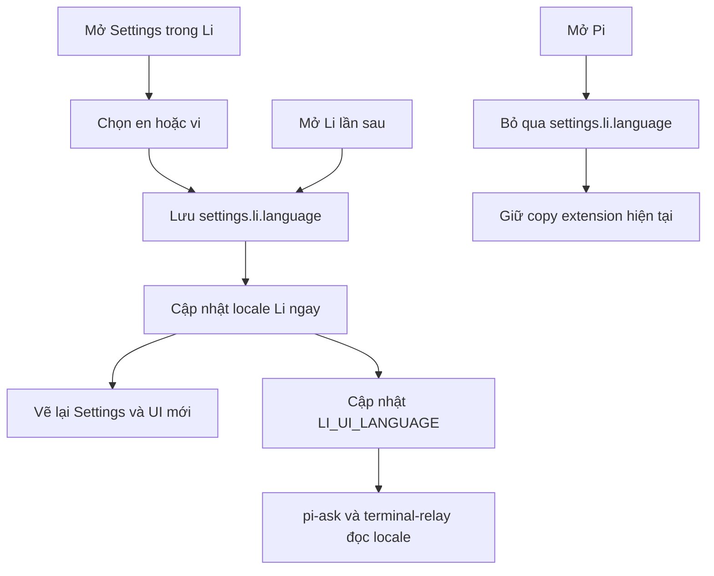

# Spec: Đổi ngôn ngữ giao diện Li giữa English và tiếng Việt

## Context Snapshot
- Project / module: repository root, branch `li/stable`; Li là TUI fork, package `@earendil-works/pi-coding-agent` đặt `piConfig.name = "li"`.
- Stack / runtime: TypeScript, npm workspaces, Node.js; Li và Pi dùng chung profile `~/.pi/agent` nhưng là hai runtime riêng.
- Current behavior: Core TUI dùng English và chưa có locale setting. `settings.li.toolOutputStyle` đã chứng minh Li có thể lưu setting trong namespace `li`; Settings chỉ hiện mục này khi `APP_NAME === "li"`. `SettingsList` còn có hint/empty-state English hardcode. Hai extension trong scope đang có static copy pha English/tiếng Việt, chưa theo locale; Pi và Li dùng chung source extension nên Pi phải giữ nguyên copy hiện tại.
- Desired behavior: Trong `/settings`, chọn English hoặc Tiếng Việt; lựa chọn được lưu, có hiệu lực ngay trong Li và vẫn còn sau khi mở Li lại. Pi bỏ qua setting Li và giữ nguyên copy hiện tại của extension.
- Relevant files to read:
  - `packages/coding-agent/src/core/settings-schema.ts` — `LiSettingsSchema`.
  - `packages/coding-agent/src/core/settings-defaults.ts` — `SETTINGS_DEFAULTS.li`.
  - `packages/coding-agent/src/core/settings-manager.ts` — getter/setter `getLiToolOutputStyle` và `setLiToolOutputStyle`.
  - `packages/coding-agent/src/modes/interactive/components/settings-selector.ts` — thêm setting Li theo `APP_NAME`.
  - `packages/tui/src/components/settings-list.ts` và `packages/tui/test/settings-list.test.ts` — cách chia chiều rộng label/value và test hẹp.
  - `packages/coding-agent/src/modes/interactive/interactive-mode.ts` — truyền config và xử lý callback setting.
  - `packages/coding-agent/src/modes/interactive/tool-output-style.ts` — pattern state Li-only trong runtime.
  - `packages/coding-agent/src/utils/shell.ts` và `packages/coding-agent/test/li-shell-env.test.ts` — shell loại các biến `LI_*` trước khi chạy lệnh ngoài.
  - Python repo `app_presets/pi/extensions/pi-ask/component.ts` — UI cố định của `ask_user`.
  - Python repo `app_presets/pi/extensions/pi-terminal-relay/approval.ts` — UI cố định của màn approval.
- Existing constraints:
  - Chỉ Li đọc và áp dụng locale; setting nằm trong `settings.li`. Extension shared phải giữ nguyên copy hiện tại khi `LI_RUNTIME !== "1"`.
  - Extension sửa tại source `app_presets/pi/extensions/` trong Python repo, không sửa tay bản runtime.
  - Giữ nguyên hành vi, màu sắc và layout TUI hiện tại; đây là thay đổi ngôn ngữ, không phải redesign.

## Objective
- Cho mày chuyển giao diện Li sang tiếng Việt để dễ dùng, rồi đổi lại English khi cần.
- Lựa chọn sống qua lần mở Li tiếp theo; không bắt restart chỉ để đổi ngôn ngữ.

## Scope
- In:
  - Thêm lựa chọn `Interface language` / `Ngôn ngữ giao diện` vào `/settings`, chỉ hiện trong Li.
  - Dịch static UI copy của interactive TUI Li: Settings, selector, status, prompt/hint, thông báo và lỗi do Li tạo.
  - Dịch empty-state, no-match và keyboard footer của shared `SettingsList` khi được gọi từ Li; `SettingsSelector` truyền copy qua optional input, còn default của component vẫn giữ nguyên cho Pi/caller khác.
  - Trong Li, static copy của form `ask_user` (`pi-ask`) và màn approval (`pi-terminal-relay`) có catalog EN/VI. Catalog EN của Li viết English copy rõ ràng cả khi source hiện tại đang là tiếng Việt.
  - Khi hai extension chạy ngoài Li, giữ nguyên chuỗi hiện có của chúng; không đổi Pi để ép tất cả copy thành English.
  - Mặc định English; locale không hợp lệ hoặc thiếu bản dịch thì fallback English.
  - Đổi ngôn ngữ có hiệu lực ngay trong Li đang chạy; text đã có trong transcript không bị dịch ngược.
- Out:
  - Không dịch câu trả lời của model, text user nhập, output tool/shell, nội dung file, command/model/provider/extension name.
  - Không dịch CLI `--help`, docs, third-party extension hay extension khác ngoài hai extension nêu trên trong revision này.
  - Không đổi default text/layout của shared `SettingsList` cho caller không truyền copy; Pi giữ nguyên.
  - Không tự dò ngôn ngữ Windows/terminal; mặc định vẫn là English.
  - Không đổi cấu trúc `/settings`, theme, separator hay style selection.

## Thuật ngữ
- `locale` = lựa chọn ngôn ngữ UI của Li; trong revision này chỉ có `en` và `vi`.
- `static UI copy` = chữ cố định do ứng dụng/extension viết sẵn, không gồm text do user, model hoặc tool cung cấp.
- `LI_UI_LANGUAGE` = biến môi trường nội bộ Li để hai extension trong scope biết locale hiện tại; không phải setting lưu trữ.

## UX Baseline
1. Keyboard: giữ nguyên điều hướng hiện tại của Settings; phím chọn/Enter đổi giá trị, Esc đóng menu.
2. Focus: giữ nguyên indicator chọn/focus của `SettingsList`; đổi locale không làm mất vị trí đang chọn.
3. A11y: đây là TUI, không có DOM semantics; không truyền thông tin chỉ bằng màu, text của lựa chọn phải đọc được.
4. Viewport: ở 40 và 80 cột, giá trị ngôn ngữ, token approval và hint thao tác thiết yếu vẫn đọc đủ; label không thiết yếu được phép co/wrap.
5. States: locale thiếu/sai hoặc key dịch thiếu phải hiện English; lựa chọn mới áp dụng ngay, không có loading state.
6. Nhất quán: dùng `SettingsList` và theme hiện có; không thêm border/chrome để phân biệt ngôn ngữ.
7. Platform: terminal TUI, keyboard là phương thức chính; touch target N/A.
8. Copy: tiếng Việt tự nhiên, ngắn; tên lệnh, phím tắt, model/provider và nội dung động giữ nguyên.

## Assumptions
1. Setting là global cho mọi phiên Li vì các setting Li hiện lưu trong shared `settings.json`; Pi bỏ qua `settings.li.language`.
2. Core catalog EN giữ wording hiện tại. Với hai extension, catalog EN của Li dùng English copy cho chrome cố định; khi chạy ngoài Li, giữ nguyên output hiện tại kể cả đoạn đang là tiếng Việt.
3. Chỉ hỗ trợ hai extension first-party nêu trong Scope; extension tùy biến khác không bị sửa hoặc đổi ngôn ngữ.

## Open Questions
- Không có blocker cho bản v1. Nếu “giao diện” phải bao gồm mọi extension đang cài, đó là mở rộng scope riêng; không tự quét/dịch toàn bộ extension trong task này.

## Approach
- Chọn: catalog EN/VI có key/type kiểm tra lúc build, không thêm dependency i18n; Li core lấy locale từ `settings.li.language`.
- Settings Manager lưu `en | vi`. Khi người dùng đổi lựa chọn, Li cập nhật localizer và rebuild Settings view ngay, giữ focus; UI tạo mới dùng locale mới. Text đã ghi vào transcript không đổi.
- Li đồng bộ locale hiện tại sang `process.env.LI_UI_LANGUAGE`; hai extension chỉ dùng catalog EN/VI khi `LI_RUNTIME === "1"`. Khi không chạy dưới Li, chúng render nguyên văn copy hiện tại; trong Li, locale `en` dùng English copy mới cho static chrome, còn locale `vi` dùng bản tiếng Việt. `shell.ts` đã xóa mọi biến `LI_*` khỏi environment chạy lệnh ngoài; thêm regression test để xác nhận biến mới không lọt ra shell.
- `SettingsList` nhận optional `copy` cho empty/no-match/footer hint. Nếu không truyền, component dùng chuỗi hiện tại; cả ba `SettingsList` trong Li `SettingsSelector` (main, warnings, model-thinking submenu) đều nhận copy localized. TUI primitive không tự đọc `LI_UI_LANGUAGE`, Pi không đổi.
- Nếu bất kỳ key nào thiếu ở catalog VI, dùng bản EN tương ứng. Nếu setting sai định dạng, dùng `en` và không làm hỏng startup.
- Lý do: setting đã có namespace Li; catalog typed tránh bỏ sót key, còn locale bridge hẹp giúp hai extension cần thiết dịch được mà không tạo API chung cho toàn bộ extension ecosystem.

## Diagram



## Bỏ qua
- Không dùng package i18n bên ngoài: 2 locale và static TUI copy chưa cần thêm dependency/runtime complexity.
- Không dịch transcript đã ghi, model/tool output hay extension tùy biến: đó không phải static UI copy do Li sở hữu.

## Risks
- Thiếu key dịch tạo màn nửa Anh nửa Việt; catalog parity test và English fallback phải chặn lỗi im lặng.
- Tiếng Việt dài hơn có thể làm label bị cắt ở terminal hẹp; cần test 40/80 cột và runtime snapshot.
- Extension source dùng chung với Pi; locale branch phải được guard bởi `LI_RUNTIME === "1"`, không đổi copy hiện tại của Pi.
- Hint hoặc token approval có thể bị cắt ở terminal hẹp; test phải chứng minh token và thao tác thiết yếu còn nguyên ở 40/80 cột.
- `LI_UI_LANGUAGE` có thể bị kế thừa bởi shell con; phải xác nhận generic `LI_*` sanitizer tiếp tục loại biến này.

## Task List

### Task 1: Setting locale và đổi ngôn ngữ ngay trong Li
- Acceptance:
  - Thêm `li.language` với giá trị `en | vi`, mặc định `en`; dữ liệu cũ thiếu key vẫn chạy như trước.
  - `/settings` chỉ trong Li có một hàng chọn locale; chỉ lưu `en | vi`. Display values là `EN · English` và `VI · Tiếng Việt`; callback map display label về code, không lưu label.
  - Khi đổi lựa chọn, giá trị được lưu ngay, Settings view chuyển ngôn ngữ không cần restart và giữ vị trí focus.
  - Locale không hợp lệ hoặc key dịch thiếu fallback English.
  - Không đổi behavior của Pi.
- UX Contract:
  - Surface: một hàng mới trong `/settings` hiện có; không thêm màn trung gian.
  - States: `en` mặc định; `vi` sau khi chọn; giá trị hỏng/missing → `en`; không có trạng thái loading.
  - Keyboard/focus: theo `SettingsList`; sau khi rebuild giữ hàng đang chọn và cho phép tiếp tục đổi ngôn ngữ.
  - Copy: label/mô tả theo locale hiện hành; giá trị hiển thị `EN · English` / `VI · Tiếng Việt` nhưng lưu nội bộ `en` / `vi`. Ở 40 cột prefix `EN` / `VI` còn nguyên, description ghi đủ tên hai ngôn ngữ.
  - Narrow width: `currentValue` dùng prefix `EN` / `VI` trước tên đầy đủ (`EN · English`, `VI · Tiếng Việt`). Ở 40 cột prefix vẫn hiện đủ; description của hàng ghi rõ cả hai tên. Không đổi layout generic của `SettingsList`/Pi.
- Skills: `flow`, `implement`, `test`, `verify`.
- Visual Ref: `packages/coding-agent/src/modes/interactive/components/settings-selector.ts` — giữ đúng layout các hàng sibling hiện tại; không tạo visual direction mới.
- Reproduce (Git Bash, repo root): `cd packages/coding-agent && node "$(git rev-parse --show-toplevel)/node_modules/vitest/dist/cli.js" --run test/settings-manager.test.ts test/settings-selector.test.ts test/li-language.test.ts`.
- Verify:
  - Test schema/default/getter/setter, lựa chọn EN/VI, đổi live, missing/invalid fallback và chỉ hiện khi `APP_NAME === "li"`.
  - Render hàng locale ở 40/80 cột: 40 cột phải hiện nguyên `EN` hoặc `VI` và description đọc đủ mapping; 80 cột hiện `EN · English` / `VI · Tiếng Việt`. Không chấp nhận giá trị mơ hồ `En` / `Ti`.
  - `npm run check` tại repo root.
- Files:
  - `packages/coding-agent/src/core/settings-schema.ts` — pattern `LiSettingsSchema.toolOutputStyle`.
  - `packages/coding-agent/src/core/settings-defaults.ts` — pattern `SETTINGS_DEFAULTS.li.toolOutputStyle`.
  - `packages/coding-agent/src/core/settings-manager.ts` — pattern `getLiToolOutputStyle` / `setLiToolOutputStyle`.
  - `packages/coding-agent/src/modes/interactive/components/settings-selector.ts` — pattern row Li-only và `SettingsList`.
  - `packages/tui/src/components/settings-list.ts` — read-only reference cho fixed-column behavior; giữ nguyên generic layout để Pi không đổi.
  - `packages/tui/test/settings-list.test.ts` — reference test; ưu tiên test giá trị locale qua `SettingsSelector` trong coding-agent.
  - `packages/coding-agent/src/modes/interactive/interactive-mode.ts` — pattern truyền `liToolOutputStyle` và callback.
  - `packages/coding-agent/src/modes/interactive/tool-output-style.ts` — pattern runtime state có guard `APP_NAME`.
  - `packages/coding-agent/src/modes/interactive/locale.ts` — module mới giữ type, catalog lookup và fallback.
  - `packages/coding-agent/test/settings-manager.test.ts` và `packages/coding-agent/test/settings-selector.test.ts` — test pattern hiện có; thêm `packages/coding-agent/test/li-language.test.ts` nếu cần cô lập locale contract.

### Task 2: Dịch static UI copy của Li core và các UI surface first-party trong scope
- Acceptance:
  - Các static UI string trong interactive Li TUI có bản EN và VI, không thiếu key; core English mặc định giữ wording hiện hành.
  - Cả ba `SettingsList` trong Li Settings flow nhận copy inject từ locale cho empty-state, no-match và keyboard footer; không có override thì các chuỗi default hiện tại giữ nguyên.
  - `pi-ask` và `pi-terminal-relay` dùng catalog Li cho labels/hints/buttons và typed-confirmation prompt cố định; câu hỏi, option, command, token và output động không bị dịch.
  - Với `LI_RUNTIME=1`, Li English hiển thị English copy rõ ràng và Li Vietnamese hiển thị bản Việt. Khi không chạy dưới Li, hai extension giữ nguyên copy hiện tại (bao gồm copy tiếng Việt), không đổi Pi.
  - Test-created `AskPickComponent` nào chưa hoàn tất/cancel phải gọi `dispose()` trong `finally`; lệnh test phải kết thúc exit code 0 sau assertions, không giữ inactivity timer.
  - Approval test được thêm vào `tsconfig.check.json`; Node 22.22.0 chạy bằng `--experimental-transform-types` và test-only `pi-tui` junction để vừa transform parameter properties vừa resolve workspace package.
  - Ở 40 và 80 cột, token xác nhận critical trong approval cùng hint thao tác cần thiết của approval/`ask_user` phải đọc đủ; approval đặt token trên dòng riêng hoặc wrap để không cắt token. Hint được wrap hoặc rút gọn mà không đổi visual direction.
  - Đổi locale trong Li áp dụng cho UI tạo sau thời điểm đổi; không rewrite transcript cũ.
- UX Contract:
  - Surface: các component TUI hiện có; giữ hierarchy/màu/điều hướng. `SettingsList` chỉ nhận copy override opt-in; caller Pi không truyền nên giữ nguyên.
  - States: catalog VI đủ key; key thiếu trong Li → EN; `LI_UI_LANGUAGE` thiếu/sai khi `LI_RUNTIME=1` → EN; không có `LI_RUNTIME=1` → giữ nguyên copy hiện tại của extension.
  - Keyboard/focus: hành vi hiện tại giữ nguyên; đổi ngôn ngữ không thay key binding.
  - Narrow: có thể wrap/rút gọn hint; token approval phải nằm nguyên vẹn trên dòng riêng nếu không vừa.
  - Content boundary: chỉ dịch chrome/copy tĩnh, không dịch dữ liệu user/model/tool.
- Skills: `flow`, `implement`, `test`, `verify`.
- Visual Ref: component TUI hiện tại trong `packages/coding-agent/src/modes/interactive/components/`; extension visual refs là `pi-ask/component.ts` và `pi-terminal-relay/approval.ts`. Giữ nguyên hierarchy/layout của các bản hiện tại.
- Reproduce (PowerShell, chạy một lần từ Python repo `app_presets/pi/extensions`):

```
$ext = (Get-Location).Path
$li = (Resolve-Path (Join-Path $ext '..\..\..\..\pi-mono-li')).Path
$junctions = @(
  @{ Link = (Join-Path $ext 'node_modules\@earendil-works\pi-tui'); Target = (Join-Path $li 'packages\tui') },
  @{ Link = (Join-Path $ext 'node_modules\@earendil-works\pi-coding-agent'); Target = (Join-Path $li 'packages\coding-agent') },
  @{ Link = (Join-Path $ext 'node_modules\typebox'); Target = (Join-Path $li 'node_modules\typebox') }
)
foreach ($item in $junctions) {
  New-Item -ItemType Directory -Force -Path (Split-Path -Parent $item.Link) | Out-Null
  if (-not (Test-Path -LiteralPath $item.Link)) { New-Item -ItemType Junction -Path $item.Link -Target $item.Target | Out-Null }
}
node --experimental-transform-types --test "$ext\pi-ask\component.test.ts" "$ext\pi-terminal-relay\approval.test.ts"
if ($LASTEXITCODE -ne 0) { exit $LASTEXITCODE }
node (Join-Path $li 'node_modules\typescript\bin\tsc') -p (Join-Path $ext 'pi-terminal-relay\tsconfig.check.json') --noEmit
if ($LASTEXITCODE -ne 0) { exit $LASTEXITCODE }
node --test "$li\packages\tui\test\settings-list.test.ts"
```

The junctions live under ignored `node_modules`; do not commit them.
- Verify:
  - Test catalog EN/VI có cùng key set, bao gồm các key `SettingsList`, và fallback EN.
  - Test `SettingsList` override hiển thị EN/VI ở cả main, warnings và model-thinking submenus; default khi không truyền override vẫn giữ English hiện tại.
  - Test `pi-ask` và approval render tại 40/80 cột; không mất token/hint thiết yếu, test luôn chuỗi prompt của `ui.input`, và copy ngoài Li giữ nguyên hiện trạng.
  - Lệnh Node tests phải kết thúc với exit code 0; `tsconfig.check.json` phải bao gồm `approval.test.ts` và lệnh `tsc` phải type-check file đó.
  - Test `LI_UI_LANGUAGE` bị loại khỏi child shell, không đổi output của extension khi `LI_RUNTIME` không bật.
- Files:
  - `packages/coding-agent/src/modes/interactive/components/**` và `packages/coding-agent/src/modes/interactive/interactive-mode.ts` — chuyển static labels/status/hints sang locale; giữ pattern component hiện có, bảo đảm mọi `SettingsList` callsite trong main/warnings/model-thinking nhận copy Li.
  - `packages/coding-agent/src/utils/shell.ts` và `packages/coding-agent/test/li-shell-env.test.ts` — xác nhận generic `LI_*` sanitization; không expose biến runtime ra shell.
  - `packages/tui/src/components/settings-list.ts` — optional copy inputs; không đổi default strings cho caller Pi.
  - `packages/tui/test/settings-list.test.ts` — kiểm default strings unchanged và copy override.
  - Python repo `app_presets/pi/extensions/pi-ask/component.ts` — static form copy; giữ behavior và `LI_RUNTIME` separator guard.
  - Python repo `app_presets/pi/extensions/pi-ask/component.test.ts` — cleanup inactivity timer trong test; test process phải thoát sạch.
  - Python repo `app_presets/pi/extensions/pi-terminal-relay/approval.ts` — static approval copy; giữ behavior và separator guard.
  - Python repo `app_presets/pi/extensions/pi-terminal-relay/approval.test.ts` — **file mới**; test approval rendering, Pi/Li locale branch và không cắt token/hint ở 40/80 cột.
  - Python repo `app_presets/pi/extensions/pi-terminal-relay/tsconfig.check.json` — thêm `approval.test.ts` vào `include` để TSC không bỏ sót test.

### Task 3: Coverage audit, docs và Li runtime verification
- Acceptance:
  - Có test catalog parity và source coverage audit cho toàn bộ static copy thuộc scope: core interactive UI, `SettingsList`, `pi-ask`, `pi-terminal-relay`. Mỗi literal được ghi nhận trong catalog hoặc allowlist Pi-only; không có UI string Li mồ côi ngoài catalog.
  - `docs/li-maintenance.md` mô tả vị trí setting, default, phạm vi locale và giới hạn extension.
  - Li build chạy được; Pi executable/profile không bị đổi bởi source hoặc extension behavior.
- UX Contract:
  - Kiểm runtime tại terminal 80×24 và 40×24; `EN`/`VI` cùng mapping đầy đủ trong description, hint `ask_user`, token và hướng dẫn approval phải đọc đủ.
  - Không đổi generic `SettingsList` layout; Pi giữ nguyên layout và copy hiện tại.
  - Dùng cùng theme, spacing và selection behavior hiện tại.
- Skills: `flow`, `implement`, `test`, `verify`.
- Visual Ref: `/settings` hiện tại trong `docs/li-maintenance.md` và `settings-selector.ts`; không yêu cầu screenshot concept mới.
- Reproduce (Git Bash, repo root): `cd packages/coding-agent && node "$(git rev-parse --show-toplevel)/node_modules/vitest/dist/cli.js" --run test/li-language.test.ts test/li-language-coverage.test.ts test/settings-selector.test.ts`; sau đó từ repo root chạy `rg -n 'add\(|theme\.(fg|bold|italic|muted)\(|hint\(|label:|description:|currentValue:|No settings available|No matching settings|Type to search|Enter/Space to change|ui\.input\(' packages/coding-agent/src/modes/interactive packages/tui/src/components/settings-list.ts ../python/app_presets/pi/extensions/pi-ask/component.ts ../python/app_presets/pi/extensions/pi-terminal-relay/approval.ts` để lập source inventory. Cuối cùng chạy `npm run check`, `node scripts/build-li.mjs --offline` và `li --version`.
- Verify:
  - Chạy targeted Vitest, `SettingsList` node:test, extension test command và TSC ở Task 1–2.
  - Review toàn bộ source inventory từ `rg`: mỗi static string trong bốn surface đã nêu phải có catalog key hoặc nằm trong nhánh Pi-only allowlist; ghi số callsite đã phân loại và số còn mồ côi (phải là 0).
  - Rebuild Li từ working tree sau khi check pass; receipt phải phản ánh source hiện tại.
  - Runtime smoke: mở Li, chuyển VI ↔ EN; mở lại Li để xác nhận persistence; mở Pi để xác nhận core UI giữ English và extension giữ nguyên copy hiện tại.
- Files:
  - `docs/li-maintenance.md` — pattern bảng Li transcript style hiện tại.
  - `packages/coding-agent/test/li-language.test.ts`, `packages/coding-agent/test/li-language-coverage.test.ts` và tests selector — behavior, catalog parity và coverage inventory.
  - `packages/coding-agent/test/li-shell-env.test.ts` — pattern xác nhận env Li không rò sang shell.

### Task 4: Mở rộng — localize menu `/` commands và các status messages còn lại
- Acceptance:
  - 24 built-in command descriptions trong menu `/` (nguồn `packages/coding-agent/src/core/slash-commands.ts`) có bản VI khi Li chạy locale `vi`; English giữ wording gốc cho Pi và locale `en`.
  - Descriptions của skill/prompt/extension commands (data động) và `argumentHint` (vd `<provider/model>`) giữ nguyên mọi locale.
  - Toàn bộ `showStatus` còn lại trong `interactive-mode.ts` (~30 static + ~11 template) đi qua catalog EN/VI; giá trị động (session id, model id, path, số đếm) giữ nguyên không dịch.
  - Status loading/success tĩnh trong model selectors (`Refreshing model catalogs…`, `Model catalogs refreshed.`) cũng theo locale Li; nội dung error, help và heading không đổi.
  - Chuỗi nằm trong nhánh `APP_NAME !== "li"` (vd `"Resumed session"`, `"Resumed session in current cwd"`) là copy Pi-only: giữ verbatim, KHÔNG đưa vào catalog.
  - `showError` không thuộc scope task này (giữ hiện trạng).
  - Catalog parity test và coverage inventory mở rộng tới hai surface mới; `npm run check`, rebuild và `li --version` pass.
- UX Contract:
  - Menu `/` và status line đọc được ở 40/80 cột; VI dài hơn có thể bị truncate cuối dòng như hiện trạng của status, không chấp nhận cắt từ khóa chính giữa tên lệnh.
  - Không đổi hành vi/điều kiện hiển thị của bất kỳ status nào — chỉ đổi ngôn ngữ chuỗi.
- Skills: `implement`, `test`, `verify`.
- Reproduce (Git Bash, repo root): `cd packages/coding-agent && node "$(git rev-parse --show-toplevel)/node_modules/vitest/dist/cli.js" --run test/li-language.test.ts test/li-language-coverage.test.ts test/li-model-selector-status.test.ts test/settings-selector.test.ts`; sau đó `npm run check` và `node scripts/build-li.mjs --offline`.
- Verify:
  - Test menu `/` render VI descriptions cho built-in commands trong Li, English cho Pi/en.
  - Test các status mới qua catalog: VI đúng, EN giữ wording gốc, biến động không bị dịch; model selector loading/success dùng đúng hai key này.
  - Coverage inventory: 0 orphan literals trên surface menu `/` + status; các nhánh Pi-only được allowlist.
- Files:
  - `packages/coding-agent/src/core/slash-commands.ts` — có thể giữ nguyên làm nguồn EN; Li lookup catalog theo command name (worker quyết điểm wire, miễn Pi không đổi).
  - `packages/coding-agent/src/modes/interactive/locale.ts` — mở rộng catalog (slash command descriptions + status keys mới).
  - `packages/coding-agent/src/modes/interactive/interactive-mode.ts` — các `showStatus` còn lại qua `liCopy()` và inject localized refresh status cho scoped-model selector.
  - `packages/coding-agent/src/modes/interactive/components/model-selector.ts` — localized loading/success status; giữ nguyên error/help copy.
  - `packages/coding-agent/test/li-language.test.ts`, `packages/coding-agent/test/li-language-coverage.test.ts`, `packages/coding-agent/test/li-model-selector-status.test.ts` — test + inventory mở rộng.

### Task 5: Localize built-in `/hotkeys` screen in Li
- Acceptance:
  - Title, section headings, table headings, and built-in shortcut action descriptions use the Li EN/VI catalog; locale `vi` shows Vietnamese and locale `en` preserves the existing English wording verbatim.
  - Key combinations remain exactly as resolved by `KeybindingsManager`; translate only surrounding explanation text, including the Windows note while preserving `Ctrl+Enter`.
  - Extension shortcut descriptions and path fallbacks remain dynamic data and are not translated; the Extensions section heading is static UI copy and is localized.
  - Shortcut order, availability, and behavior do not change; Markdown remains readable at 40 and 80 columns.
- UX Contract:
  - Keep the current `/hotkeys` Markdown table and styling; no new screen or navigation.
  - English copy is the compatibility baseline; Pi behavior stays English.
- Skills: `implement`, `test`, `verify`.
- Reproduce (Git Bash, repo root): `cd packages/coding-agent && node "$(git rev-parse --show-toplevel)/node_modules/vitest/dist/cli.js" --run test/li-hotkeys.test.ts test/li-language-coverage.test.ts test/li-language.test.ts`; then `npm run check` and `node scripts/build-li.mjs --offline`.
- Verify:
  - Test actual `/hotkeys` Markdown in EN and VI, including all section labels and representative actions; EN strings remain verbatim.
  - Render at 40/80 columns; each output line fits and shortcut/action text survives Markdown wrapping.
  - Test keybinding display values and extension-provided descriptions survive unchanged under VI; test the Windows `Ctrl+Enter` note.
  - Coverage audit confirms built-in hotkeys copy lives in the locale catalog, not as orphan literals in `handleHotkeysCommand()`.
- Files:
  - `packages/coding-agent/src/modes/interactive/locale.ts` — typed hotkeys copy catalog.
  - `packages/coding-agent/src/modes/interactive/interactive-mode.ts` — build `/hotkeys` Markdown from `liCopy().hotkeys` while preserving dynamic key labels/extensions.
  - `packages/coding-agent/test/li-hotkeys.test.ts` and `packages/coding-agent/test/li-language-coverage.test.ts` — rendered copy and source coverage.

## Checkpoints
- Sau Task 1: settings manager + selector tests và `npm run check` PASS; locale đổi live trong menu.
- Sau Task 2: catalog parity + core/extension tests PASS; English ngoài Li không đổi.
- Trước UAT: Li build PASS, receipt khớp source; kiểm Settings/`ask_user`/approval ở 80×24 và 40×24.

## External Review Brief
### Reviewer cần phán
- Đây có đúng phạm vi nhỏ nhất để người dùng đổi UI Li sang tiếng Việt mà không làm Pi đổi theo không?
- Catalog EN của Li có tách rõ khỏi copy Pi hiện tại, nhất là các chuỗi source đang là tiếng Việt không?
- Cách giữ nguyên Pi nhưng đổi copy của Li có guard/test đủ rõ không?
- Hint/token approval và giá trị Settings còn đọc đủ ở 40 cột không?
- Có mâu thuẫn giữa “áp dụng ngay” và việc không rewrite transcript cũ không?
- Scope loại extension khác có làm trải nghiệm bị nửa Anh nửa Việt quá mức không?
- Task list, catalog coverage và test có bắt được fallback, key thiếu, terminal hẹp và locale rò sang Pi/shell không?
### Reviewer nên đọc trước
- Spec này.
- `packages/coding-agent/src/core/settings-schema.ts`, `settings-defaults.ts`, `settings-manager.ts`.
- `packages/coding-agent/src/modes/interactive/components/settings-selector.ts` và `interactive-mode.ts`.
- `packages/coding-agent/src/utils/shell.ts` + `test/li-shell-env.test.ts`.
- Hai extension source/test được liệt kê trong Task 2.
- `docs/li-maintenance.md` và profile `knowledge/project-profiles/tui-cli-stack.md`.
### Lens
- Dedicated UI/flow review: hành trình đổi locale, immediate feedback, TUI width/focus, phạm vi bản dịch.
- Không implement; không review branding hay đề xuất redesign.

## User Test

| Hành động | Kết quả kỳ vọng | Chuẩn nhìn |
|---|---|---|
| Mở `/settings` trong Li mới hoặc chưa có setting, rồi đi tới hàng ngôn ngữ | Giao diện English, có hàng chọn ngôn ngữ | Hàng ghi `Interface language`; ở 80 cột thấy `EN · English`, ở 40 cột thấy `EN`; description của hàng giải thích `EN = English`, `VI = Tiếng Việt` |
| Chọn `Tiếng Việt` | Menu, keyboard footer và các submenu Settings đổi sang tiếng Việt, không restart | Không còn hint English trong các hàng thuộc scope; focus không nhảy |
| Mở menu `/` trong Li VI | Built-in command descriptions hiện tiếng Việt; argument hint và command động giữ nguyên | `settings` có mô tả `Mở menu settings`; skill/prompt/extension descriptions không bị dịch |
| Gọi `/hotkeys` trong Li VI | Title, headings và built-in shortcut descriptions hiện tiếng Việt | Tổ hợp phím giữ nguyên; extension description không bị dịch; nội dung đọc được ở 40/80 cột |
| Dùng `/copy` trong Li VI | Status hiện `Đã copy message agent cuối vào clipboard` | Nội dung message chỉ được copy, không đổi |
| Gọi `ask_user` và mở approval trong Li | Chọn tiếng Việt thì chrome và typed-confirmation prompt hiện tiếng Việt; English thì dùng English | Câu hỏi/lệnh/token giữ nguyên; ở 40/80 cột token approval và hint thao tác hiện đủ, không bị cắt |
| Gọi cùng extension trong Pi | Copy hiển thị y như trước thay đổi | Không bị chuyển sang catalog Li hoặc bị ép thành English |
| Đóng/mở lại Li | Tiếng Việt được giữ | Không cần chọn lại |
| Chọn lại English rồi mở Pi | Li về English; Pi giữ nguyên copy hiện tại | Không đổi giao diện/copy Pi; Pi không nhận locale Li ngoài key `li.*` |
| Resize terminal về 40 và 80 cột | Setting, `ask_user`, approval và `/hotkeys` vẫn đọc/chọn được | 40 cột thấy `EN`/`VI` cùng description đầy đủ; 80 cột thấy tên đầy đủ; token approval và hint thao tác không bị cắt; hotkeys không tràn ngang; Pi giữ layout/copy hiện tại |

Trả lời Y/N sau khi test:
1. Giao diện Settings và các màn trong scope có vừa terminal, không che text/control quan trọng không?
2. Có đổi locale bằng keyboard và tiếp tục thao tác được không?
3. Focus/selection có nhìn thấy và không nhảy sau khi đổi không?
4. Locale lỗi/missing có fallback English rõ ràng, không làm menu hỏng không?
5. UI Li có giữ đúng style hiện hành, core Pi vẫn English và extension copy trong Pi không đổi không?
6. `/hotkeys` dịch phần built-in nhưng giữ nguyên tổ hợp phím và description động của extension không?

## Maintenance Context
- Locale catalog và fallback nằm ở `packages/coding-agent/src/modes/interactive/locale.ts`; thêm static Li UI copy tại đây và giữ EN/VI key shape parity.
- `InteractiveMode` áp locale từ `settings.li.language`; callback đổi ngôn ngữ lưu setting, rebuild Settings và slash autocomplete (provider giữ snapshot mô tả lệnh). `/hotkeys` đọc catalog khi mở.
- Pi phải dùng EN; `SettingsList` mặc định không đổi. Extensions chỉ đọc locale khi `LI_RUNTIME === "1"`; child shell loại mọi `LI_*`.
- `/` built-in descriptions và `/hotkeys` built-in labels/actions là static copy; keybindings và extension shortcut descriptions là data, không dịch. `showError`, selector help/error và dynamic extension descriptions hiện ngoài phạm vi.
- Verify commands: targeted Vitest 95/95, `SettingsList` node:test 4/4, extension node:test 23/23, root + extension TSC, `npm run check`, `node scripts/build-li.mjs --offline`, `bin/li.cmd --version`.
- Human UAT: user xác nhận combined checklist PASS; không lưu screenshot artifact.

## Completion Gates
- [x] `npm run check` và targeted tests PASS (bao gồm Task 4 sau khi mở scope).
- [x] Catalog parity/fallback, shell env isolation và Pi extension guard PASS.
- [x] Menu `/` + status messages còn lại dịch trong Li, Pi giữ nguyên (Task 4).
- [x] `/hotkeys` localize static copy trong Li VI; key combinations và extension descriptions giữ nguyên (Task 5).
- [x] Li build + runtime smoke PASS; kiểm terminal 40/80 cột có evidence.
- [x] `/verify` đối chiếu từng acceptance với source/test/runtime evidence.
- [x] User Test checklist PASS.
- [x] Chỉ sau các gate trên mới archive spec bằng `spec-archive`; chưa commit/push nếu user chưa yêu cầu.
